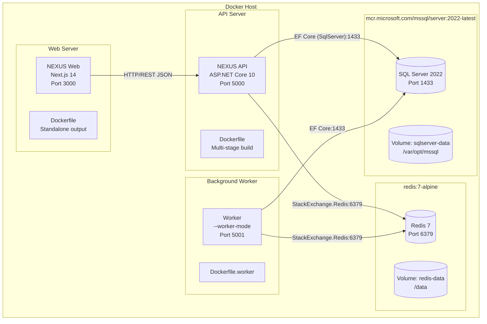

# Deployment Architecture

---

## Local Development Setup

Two commands to start development (after infrastructure is running):

```bash
# Start API (from apps/api directory)
dotnet run

# Start frontend (from apps/web directory)
npm run dev
```

Or from root via npm scripts:
```bash
npm run dev:api    # -> cd apps/api && dotnet run
npm run dev:web    # -> cd apps/web && npm run dev
```

**Evidence:** `README.md:54-57`, `package.json:7-8`

### Prerequisites
- Node.js 18+
- .NET 10 SDK
- SQL Server 2022 (local install, SQL Express, or Docker)
- Redis 7
- Docker & Docker Compose (optional)

---

## Docker Compose

5 services defined in `docker-compose.yml`:

```yaml
services:
  sqlserver:  # mcr.microsoft.com/mssql/server:2022-latest, port 1433
  redis:      # redis:7-alpine, port 6379
  api:        # ./apps/api/Dockerfile, port 5000
  web:        # ./apps/web/Dockerfile, port 3000
  worker:     # ./apps/api/Dockerfile.worker, internal
volumes:
  sqlserver-data:
  redis-data:
networks:
  default: nexus-network
```

**Evidence:** `docker-compose.yml` (91 lines)

### Service Details

| Service | Image | Port(s) | Healthcheck | Depends On |
|---------|-------|---------|-------------|------------|
| sqlserver | `mcr.microsoft.com/mssql/server:2022-latest` | 1433:1433 | `/opt/mssql-tools18/bin/sqlcmd -S localhost -U sa -C -Q \"SELECT 1\"` | - |
| redis | `redis:7-alpine` | 6379:6379 | `redis-cli ping` | - |
| api | `./apps/api/Dockerfile` | 5000:5000 | - | sqlserver (healthy), redis (healthy) |
| web | `./apps/web/Dockerfile` | 3000:3000 | - | api |
| worker | `./apps/api/Dockerfile.worker` | - | - | sqlserver (healthy), redis (healthy) |

### Health Checks

| Service | Test | Interval | Timeout | Retries |
|---------|------|----------|---------|---------|
| sqlserver | `CMD-SHELL /opt/mssql-tools18/bin/sqlcmd -S localhost -U sa -P \"Nexus_Dev_2024!\" -C -Q \"SELECT 1\"` | 15s | 5s | 10 |
| redis | `CMD redis-cli ping` | 10s | 5s | 5 |

### Volumes

| Volume | Mount | Purpose |
|--------|-------|---------|
| `sqlserver-data` | `/var/opt/mssql` | Persistent database storage |
| `redis-data` | `/data` | Persistent cache storage |

### Network

All services share `nexus-network` bridge network.

---

## Dockerfiles

### API (`apps/api/Dockerfile`)

| Stage | Base Image | Operations |
|-------|-----------|------------|
| build | `mcr.microsoft.com/dotnet/sdk:10.0` | Copy .csproj files, restore, publish Release to /app |
| runtime | `mcr.microsoft.com/dotnet/aspnet:10.0` | Copy published output, expose 5000, entrypoint `dotnet NEXUS.Api.dll` |

**Resolved (ADR-005):** .NET 10 images with `net10.0` TFM -- consistent.

### Worker (`apps/api/Dockerfile.worker`)

| Stage | Base Image | Operations |
|-------|-----------|------------|
| build | `mcr.microsoft.com/dotnet/sdk:10.0` | Same multi-stage build as API |
| runtime | `mcr.microsoft.com/dotnet/aspnet:10.0` | Entrypoint: `dotnet NEXUS.Api.dll --worker-mode`, port 5001 |

### Web (`apps/web/Dockerfile`)

| Stage | Base Image | Operations |
|-------|-----------|------------|
| deps | `node:20-alpine` | `npm ci` |
| builder | `node:20-alpine` | Copy node_modules, `npm run build` |
| runner | `node:20-alpine` | Standalone output, non-root `nextjs` user, expose 3000, `node server.js` |

Uses `.next/standalone` output for minimal production image.

---

## Environment Variables

### API (`docker-compose.yml` + `appsettings.json`)

| Variable | Value | Source |
|----------|-------|--------|
| `ASPNETCORE_ENVIRONMENT` | `Development` | docker-compose |
| `ASPNETCORE_URLS` | `http://+:5000` | docker-compose + Dockerfile |
| `ConnectionStrings__DefaultConnection` | `Server=sqlserver;Database=NexusPmo;User Id=sa;Password=Nexus_Dev_2024!;TrustServerCertificate=True;MultipleActiveResultSets=true` | docker-compose |
| `Redis__ConnectionString` | `redis:6379` | docker-compose |

### Web (`docker-compose.yml` + `.env.local`)

| Variable | Value | Source |
|----------|-------|--------|
| `NODE_ENV` | `production` | Dockerfile |
| `NEXT_PUBLIC_API_URL` | `http://localhost:5000/api` | docker-compose |

### appsettings.json (fallback)

| Key | Value |
|-----|-------|
| `ConnectionStrings:DefaultConnection` | `Server=localhost;Database=NexusPmo;Trusted_Connection=True;TrustServerCertificate=True;MultipleActiveResultSets=true` |
| `Jwt:Secret` | `NEXUS-Demo-Secret-Key-Minimum-16-Chars!` |
| `Jwt:Issuer` | `NEXUS` |
| `Jwt:Audience` | `NEXUS-API` |
| `Jwt:ExpiryHours` | `8` |
| `Redis:ConnectionString` | `localhost:6379` |
| `Redis:InstanceName` | `NEXUS` |

**Evidence:** `docker-compose.yml:41-46`, `appsettings.json:10-23`

---

## Port Mapping

| Port | Service | Protocol |
|------|---------|----------|
| 1433 | SQL Server | TCP |
| 6379 | Redis | TCP |
| 5000 | API | HTTP |
| 3000 | Web | HTTP |

---

## Startup Order

1. SQL Server and Redis start in parallel (no dependencies)
2. API waits for both services to be healthy (depends_on with condition: service_healthy)
3. Worker waits for both databases to be healthy
4. Web starts after API (depends_on without health condition)

---

## Deployment Diagram



---

## Production Security Concerns

| Issue | Details |
|-------|---------|
| Hardcoded DB password | `MSSQL_SA_PASSWORD: Nexus_Dev_2024!` in docker-compose.yml |
| Hardcoded JWT secret | `NEXUS-Demo-Secret-Key-Minimum-16-Chars!` in appsettings.json |
| No HTTPS enforcement | CORS allows localhost origins only, no TLS termination configured |
| No rate limiting | No rate limiting middleware found |
| No secrets management | No vault/secret store integration |
