# Domain Model

All entities inherit from `BaseEntity` in `NEXUS.SharedKernel` which provides: `Id` (Guid), `TenantId`, `CreatedAt`, `UpdatedAt`, `CreatedBy`, `UpdatedBy`, `IsDeleted`, `RowVersion`.

---

## Tenant & Identity

| Entity | Table | Key Fields | Module |
|--------|-------|------------|--------|
| `Tenant` | (implied via ITenantEntity) | N/A | SharedKernel |
| `User` | Users | Email, PasswordHash, FirstName, LastName, JobTitle, IsActive | Identity |
| `Role` | Roles | Name, Description, Category, IsSystem | Identity |
| `Permission` | Permissions | Name (resource.action), Resource, Action | Identity |
| `UserRole` | UserRoles | UserId, RoleId | Identity |
| `UserSession` | UserSessions | UserId, Token, ExpiresAt, IsActive | Identity |

**Evidence:** `AppDbContext.cs:29-33`

---

## Organization

| Entity | Table | Key Fields | Module |
|--------|-------|------------|--------|
| `Organization` | Organizations | Name, Code, Description, Email, Website, IsActive | Organization |
| `BusinessUnit` | BusinessUnits | Name, Code, OrganizationId, HeadId | Organization |
| `Department` | Departments | Name, Code, BusinessUnitId, ManagerId | Organization |
| `Team` | Teams | Name, Code, DepartmentId, LeadId | Organization |
| `Location` | Locations | Name, Address, City, Country, TimeZone | Organization |
| `WorkingCalendar` | WorkingCalendars | Name, Description, WeekStartDay, WorkingDays JSON | Organization |
| `Holiday` | Holidays | Name, Date, Type, CalendarId | Organization |
| `Lookup` | Lookups | Category, Code, Value, SortOrder, IsActive | Organization |
| `Currency` | Currencies | Code, Name, Symbol, ExchangeRate | Organization |
| `CostCentre` | CostCentres | Code, Name, DepartmentId, BudgetHolderId | Organization |

**Evidence:** `AppDbContext.cs:35-44`, `SeedDataProvider.cs:188-199`

---

## Portfolio

| Entity | Table | Key Fields | Module |
|--------|-------|------------|--------|
| `Portfolio` | Portfolios | Name, Code, Status, OwnerId, TotalBudget, ActualSpend, Health, Priority | Portfolio |
| `Program` | Programs | Name, PortfolioId, Status, ProgramManagerId, Budget, ActualSpend, Health | Portfolio |
| `StrategicObjective` | StrategicObjectives | Name, Description, PortfolioId, TargetDate, Progress, Status | Portfolio |
| `PortfolioHealth` | PortfolioHealths | PortfolioId, HealthStatus, Score, AssessmentDate, AssessedBy | Portfolio |
| `PortfolioBudget` | PortfolioBudgets | PortfolioId, FiscalYear, TotalAllocated, TotalSpent, Currency | Portfolio |
| `PortfolioRisk` | PortfolioRisks | PortfolioId, RiskId, ImpactScore, LikelihoodScore, MitigationStatus | Portfolio |

**Evidence:** `AppDbContext.cs:46-51`, `SeedDataProvider.cs:202-221` (4 portfolios, 7 programs seeded)

---

## Project Management

| Entity | Table | Key Fields | Module |
|--------|-------|------------|--------|
| `Project` | Projects | Name, Code, Status, Priority, Phase, PortfolioId, ProjectManagerId, StartDate, EndDate, Budget, ActualCost, PlannedValue, EarnedValue, CostVariance, ScheduleVariance, Progress, Health, RiskRating | ProjectManagement |
| `ProjectMember` | ProjectMembers | ProjectId, UserId, Role, AllocationPercentage, StartDate, EndDate | ProjectManagement |
| `ProjectPhase` | ProjectPhases | ProjectId, Name, Order, StartDate, EndDate, Status, GateApproval | ProjectManagement |
| `ProjectStakeholder` | ProjectStakeholders | ProjectId, UserId, Role, Influence, Interest, EngagementLevel | ProjectManagement |
| `ProjectSchedule` | ProjectSchedules | ProjectId, BaselineDate, CurrentForecast, VarianceDays, CriticalPath JSON | ProjectManagement |
| `WorkBreakdownStructure` | WorkBreakdownStructures | ProjectId, ParentId, Code, Name, WorkPackage, Deliverable, AssignedTo | ProjectManagement |
| `Milestone` | Milestones | ProjectId, Name, DueDate, Status, Category, CompletionPercentage | ProjectManagement |
| `Baseline` | Baselines | ProjectId, Name, Version, Date, ScheduleData JSON, CostData JSON | ProjectManagement |
| `Deliverable` | Deliverables | ProjectId, Name, Description, Status, DueDate, AcceptanceCriteria, AcceptedBy | ProjectManagement |
| `ProjectStatusReport` | ProjectStatusReports | ProjectId, Period, Status, Health, Progress, KeyAchievements, KeyRisks, NextSteps | ProjectManagement |

**Evidence:** `AppDbContext.cs:53-62`, `SeedDataProvider.cs:223-328` (24 projects seeded with EVM data)

---

## Work Items

| Entity | Table | Key Fields | Module |
|--------|-------|------------|--------|
| `WorkItem` | WorkItems | Title, Type (enum: Epic/Story/Task/Bug/Subtask), Priority, Status, Source (Internal/Jira/ServiceNow/AzureDevOps/Email), ProjectId, AssigneeId, ReporterId, ParentId, StoryPoints, EstimatedHours, ActualHours, StartDate, DueDate, CompletedAt, Tags, Labels, SortOrder | WorkItems |
| `WorkItemAssignment` | WorkItemAssignments | WorkItemId, UserId, AssignedAt, AssignedBy, Role, Status | WorkItems |

**Evidence:** `AppDbContext.cs:64-65`, `SeedDataProvider.cs:400-422` (320 work items seeded)

---

## Resource Management

| Entity | Table | Key Fields | Module |
|--------|-------|------------|--------|
| `Resource` | Resources | UserId, Name, JobTitle, Email, Type (Employee/Outsourced), Status, CostPerHour, BillableRate, EmploymentType, IsActive | ResourceManagement |
| `ResourceSkill` | ResourceSkills | ResourceId, SkillId, ProficiencyLevel, YearsOfExperience, LastUsedDate | ResourceManagement |
| `Skill` | Skills | Name, Category, Description | ResourceManagement |
| `ResourceAllocation` | ResourceAllocations | ResourceId, ProjectId, StartDate, EndDate, AllocationPercentage, Role, Status | ResourceManagement |
| `ResourceRequest` | ResourceRequests | ProjectId, RequestedBy, SkillId, Quantity, StartDate, EndDate, Priority, Status | ResourceManagement |
| `RateCard` | RateCards | ResourceId, Role, DailyRate, HourlyRate, EffectiveDate, ExpiryDate, Currency | ResourceManagement |
| `Contract` | Contracts | ResourceId, VendorId, Type, StartDate, EndDate, Rate, NoticePeriod, Status | ResourceManagement |
| `ResourceCalendar` | ResourceCalendars | ResourceId, Date, IsWorkingDay, StartTime, EndTime, BreakDuration | ResourceManagement |
| `Vendor` | Vendors | Name, Code, ContactPerson, Email, Phone, Services JSON, IsActive | ResourceManagement |

**Evidence:** `AppDbContext.cs:67-75`, `SeedDataProvider.cs:377-398` (120 resources seeded)

---

## Cost Management

| Entity | Table | Key Fields | Module |
|--------|-------|------------|--------|
| `Budget` | Budgets | Name, ProjectId, Category (Capital/Operational/Labour), PlannedAmount, ApprovedAmount, ActualAmount, CommittedAmount, ForecastAmount, Currency, FiscalYear, Status | CostManagement |
| `CostEntry` | CostEntries | ProjectId, Category, Description, Amount, Currency, IncurredDate, Type (Direct/Indirect), Status | CostManagement |
| `CostCategory` | CostCategories | Name, Code, Type, Description, ParentId | CostManagement |
| `CostApproval` | CostApprovals | CostEntryId, ApprovedBy, ApprovedAmount, Comments, ApprovedAt | CostManagement |
| `Invoice` | Invoices | VendorId, ProjectId, InvoiceNumber, Amount, Currency, Status, DueDate, PaidDate | CostManagement |
| `PurchaseCommitment` | PurchaseCommitments | ProjectId, VendorId, Description, Amount, CommittedDate, ExpectedDeliveryDate, Status | CostManagement |

**Evidence:** `AppDbContext.cs:77-82`, `SeedDataProvider.cs:545-587` (24 budgets, 50 cost entries seeded)

---

## Risk Management

| Entity | Table | Key Fields | Module |
|--------|-------|------------|--------|
| `Risk` | Risks | Title, ProjectId, Impact (High/Medium/Low), Likelihood, RiskLevel (Critical/High/Medium/Low), Status (Open/Mitigating/Closed/Monitoring), PotentialCost, PotentialDelay, OwnerId, IdentifiedDate | RiskManagement |
| `RiskCategory` | RiskCategories | Name, Code, Description, Color | RiskManagement |
| `RiskMitigation` | RiskMitigations | RiskId, Description, OwnerId, DueDate, Status, Effectiveness | RiskManagement |
| `RiskContingency` | RiskContingencies | RiskId, Description, TriggerCondition, OwnerId, Budget, Effectiveness | RiskManagement |

**Evidence:** `AppDbContext.cs:84-87`, `SeedDataProvider.cs:442-462` (28 risks seeded)

---

## Issue Management

| Entity | Table | Key Fields | Module |
|--------|-------|------------|--------|
| `Issue` | Issues | Title, ProjectId, Severity (Critical/Major/Minor), Priority, Status (Open/InProgress/Resolved), AssigneeId, ReporterId, IdentifiedDate, ResolvedDate | IssueManagement |
| `IssueCategory` | IssueCategories | Name, Code, Description, DefaultPriority | IssueManagement |
| `IssueAction` | IssueActions | IssueId, Description, OwnerId, DueDate, Status, CompletedAt | IssueManagement |

**Evidence:** `AppDbContext.cs:89-91`, `SeedDataProvider.cs:464-483` (17 issues seeded)

---

## Meetings

| Entity | Table | Key Fields | Module |
|--------|-------|------------|--------|
| `Meeting` | Meetings | Title, ProjectId, MeetingType (Virtual/InPerson/Hybrid), StartTime, EndTime, Status (Scheduled/Completed/Cancelled), OrganizerId, Location, MeetingLink, RecurrenceRule | Meetings |
| `MeetingAgenda` | MeetingAgendas | MeetingId, Title, Description, DurationMinutes, Order, OwnerId | Meetings |
| `MeetingParticipant` | MeetingParticipants | MeetingId, nullable UserId or required Email, optional Name snapshot, Attendance (Pending/Accepted/Declined/Tentative), JoinedAt, LeftAt | Meetings |
| `MeetingMinutes` | MeetingMinutes | MeetingId, Content, ActionItems JSON, CreatedBy, CreatedAt | Meetings |
| `MeetingAction` | MeetingActions | MeetingId, Description, OwnerId, DueDate, Status (Open/InProgress/Completed), CompletedAt | Meetings |

**Evidence:** `AppDbContext.cs:93-97`, `SeedDataProvider.cs:485-503` (22 meetings seeded)

---

## Workflow Engine

| Entity | Table | Key Fields | Module |
|--------|-------|------------|--------|
| `WorkflowTemplate` | WorkflowTemplates | Name, Description, Category, States JSON, Transitions JSON, Version | WorkflowEngine |
| `WorkflowVersion` | WorkflowVersions | TemplateId, VersionNumber, Definition JSON, Status, PublishedAt | WorkflowEngine |
| `WorkflowInstance` | WorkflowInstances | TemplateId, EntityType, EntityId, CurrentState, Status, StartedAt, CompletedAt | WorkflowEngine |
| `WorkflowState` | WorkflowStates | InstanceId, StateName, EnteredAt, ExitedAt, PerformedBy, Comment | WorkflowEngine |
| `WorkflowTransition` | WorkflowTransitions | TemplateId, FromState, ToState, Name, RequiredRole, Conditions JSON | WorkflowEngine |
| `WorkflowCondition` | WorkflowConditions | TransitionId, Field, Operator, Value, LogicOperator | WorkflowEngine |
| `SLA` | SLAs | TemplateId, Name, Duration, Unit, WarningThreshold, CriticalThreshold, Action | WorkflowEngine |
| `Escalation` | Escalations | SLAId, EscalationLevel, NotifyUserIds JSON, EscalateToId, Action, Timeout | WorkflowEngine |

**Evidence:** `AppDbContext.cs:99-106`

---

## Approvals

| Entity | Table | Key Fields | Module |
|--------|-------|------------|--------|
| `ApprovalRequest` | ApprovalRequests | Title, EntityType, EntityId, Type, Status (Pending/Approved/Rejected/InProgress), Priority, Amount, RequestedBy, RequiredBy, Comments | Approvals |
| `ApprovalAction` | ApprovalActions | ApprovalRequestId, ApproverId, Action (Approved/Rejected/Delegated), Comment, ActionedAt | Approvals |
| `Delegation` | Delegations | FromUserId, ToUserId, StartDate, EndDate, EntityTypes JSON, IsActive | Approvals |

**Evidence:** `AppDbContext.cs:108-110`, `SeedDataProvider.cs:505-523` (18 approval requests seeded)

---

## Notifications

| Entity | Table | Key Fields | Module |
|--------|-------|------------|--------|
| `Notification` | Notifications | TenantId, UserId, Title, Body, Type, IsRead, IsInAppVisible, SentAt, ReadAt | Notifications |
| `NotificationDelivery` | NotificationDeliveries | TenantId, NotificationId, Channel, Status, AttemptCount, NextAttemptAt, ProcessingStartedAt, LeaseId | Notifications |
| `NotificationDeliveryAttempt` | NotificationDeliveryAttempts | DeliveryId, DeviceTokenId, Status, AttemptCount, NextAttemptAt, DeliveredAt, FailureCategory | Notifications |
| `NotificationPreference` | NotificationPreferences | TenantId, UserId, Type, IsInAppEnabled, IsPushEnabled, IsEmailEnabled | Notifications |
| `UserDeviceToken` | UserDeviceTokens | TenantId, UserId, Token, TokenHash, Platform, IsActive, LastSeenAt | Notifications |

**Evidence:** `AppDbContext.cs` notification DbSets, `NotificationDeliveryProcessor.cs`, `NotificationService.cs`, `SeedDataProvider.cs:525-543` (30 notifications seeded)

---

## Documents

| Entity | Table | Key Fields | Module |
|--------|-------|------------|--------|
| `Document` | Documents | Name, Description, ProjectId, CategoryId, FileName, FileSize, MimeType, StoragePath, Status, OwnerId | Documents |
| `DocumentVersion` | DocumentVersions | DocumentId, VersionNumber, FileName, FileSize, StoragePath, UploadedBy, UploadedAt, Notes | Documents |
| `DocumentCategory` | DocumentCategories | Name, Code, Description, ParentId, Icon | Documents |
| `DocumentReview` | DocumentReviews | DocumentId, ReviewerId, Status (Pending/Approved/Rejected/ChangesRequested), Comments, ReviewedAt | Documents |

**Evidence:** `AppDbContext.cs:117-120`

---

## Reporting

| Entity | Table | Key Fields | Module |
|--------|-------|------------|--------|
| `ReportDefinition` | ReportDefinitions | Name, Description, Category, Type, Parameters JSON, Query JSON, OwnerId | Reporting |
| `ReportSchedule` | ReportSchedules | ReportId, Frequency, CronExpression, Recipients JSON, LastRunAt, NextRunAt, IsActive | Reporting |
| `ReportExport` | ReportExports | ReportId, Format (PDF/Excel/CSV), FileName, FileSize, GeneratedAt, GeneratedBy, Status | Reporting |

**Evidence:** `AppDbContext.cs:122-124`

---

## Audit

| Entity | Table | Key Fields | Module |
|--------|-------|------------|--------|
| `AuditEntry` | AuditEntries | EntityType, EntityId, Action, Changes JSON, PerformedBy, PerformedAt, CorrelationId | Audit |
| `AuditActivity` | AuditActivities | UserId, Activity, ResourceType, ResourceId, Details JSON, IpAddress, UserAgent | Audit |

**Evidence:** `AppDbContext.cs:126-127`

---

## Integrations

| Entity | Table | Key Fields | Module |
|--------|-------|------------|--------|
| `IntegrationConnection` | IntegrationConnections | Name, ProviderType, Configuration JSON, CredentialsEncrypted, IsActive, LastTestedAt | Integrations |
| `IntegrationSync` | IntegrationSyncs | ConnectionId, Status, StartedAt, CompletedAt, ItemsProcessed, ItemsFailed, ErrorLog JSON | Integrations |
| `IntegrationWebhook` | IntegrationWebhooks | ConnectionId, Url, Secret, Events JSON, IsActive, LastTriggeredAt | Integrations |
| `SyncConflict` | SyncConflicts | SyncId, EntityType, EntityId, SourceData JSON, TargetData JSON, Resolution (SourceWins/TargetWins/Merged/Manual), ResolvedAt, ResolvedBy | Integrations |

**Evidence:** `AppDbContext.cs:129-132`

---

## Plugin Management

| Entity | Table | Key Fields | Module |
|--------|-------|------------|--------|
| `Plugin` | Plugins | Name, Description, Version, Author, Manifest JSON, AssemblyName, Status (Discovered/Registered/Installed/Active/Inactive) | PluginManagement |
| `TenantPlugin` | TenantPlugins | TenantId, PluginId, Status (Active/Inactive), ActivatedAt, Configuration JSON | PluginManagement |
| `PluginDependency` | PluginDependencies | PluginId, DependentPluginId, VersionRange, IsOptional | PluginManagement |

**Evidence:** `AppDbContext.cs:134-136`

---

## AI Planning

| Entity | Table | Key Fields | Module |
|--------|-------|------------|--------|
| `AIPlanRequest` | AIPlanRequests | UserId, RequestType (GeneratePlan/ReviewPlan/AnalyzeRisk), InputData JSON, Parameters JSON, Status (Pending/Processing/Completed/Failed), CreatedAt | AIPlanning |
| `AIPlanResponse` | AIPlanResponses | RequestId, ResultData JSON, Confidence, ProcessingTime, ProviderUsed, ErrorMessage | AIPlanning |

**Evidence:** `AppDbContext.cs:138-139`

---

## Entity Relationship Diagram (Simplified)

```mermaid
erDiagram
    Tenant ||--o{ User : "has"
    User ||--o{ UserRole : "assigned"
    Role ||--o{ UserRole : "defines"
    Role ||--o{ Permission : "grants"
    User ||--o{ UserSession : "creates"

    Organization ||--o{ BusinessUnit : "contains"
    BusinessUnit ||--o{ Department : "contains"
    Department ||--o{ Team : "contains"

    Portfolio ||--o{ Program : "contains"
    Portfolio ||--o{ PortfolioHealth : "tracks"
    Portfolio ||--o{ PortfolioBudget : "budgets"
    Program ||--o{ Project : "contains"

    Project ||--o{ WorkItem : "has"
    Project ||--o{ Milestone : "tracks"
    Project ||--o{ ProjectPhase : "phases"
    Project ||--o{ ProjectMember : "staffs"
    Project ||--o{ Deliverable : "produces"
    Project ||--o{ Baseline : "baselines"
    Project ||--o{ ProjectStatusReport : "reports"
    Project ||--o{ ProjectSchedule : "schedules"
    Project ||--o{ WorkBreakdownStructure : "decomposes"
    Project ||--o{ ProjectStakeholder : "engages"

    WorkItem ||--o{ WorkItemAssignment : "assigns"

    Resource ||--o{ ResourceAllocation : "allocated_to"
    Project ||--o{ ResourceAllocation : "receives"
    Resource ||--o{ ResourceSkill : "skilled"
    Skill ||--o{ ResourceSkill : "required_by"
    Resource ||--o{ RateCard : "priced"
    Resource ||--o{ Contract : "contracted"
    Vendor ||--o{ Contract : "provides"

    Project ||--o{ Budget : "budgeted"
    Budget ||--o{ CostEntry : "transacted"
    CostEntry ||--o{ CostApproval : "approved"
    Budget ||--o{ PurchaseCommitment : "committed"
    Project ||--o{ Invoice : "invoiced"

    Project ||--o{ Risk : "has_risks"
    Risk ||--o{ RiskMitigation : "mitigates"
    Risk ||--o{ RiskContingency : "contingency"

    Project ||--o{ Issue : "has_issues"
    Issue ||--o{ IssueAction : "actions"

    Project ||--o{ Meeting : "schedules"
    Meeting ||--o{ MeetingAgenda : "agendas"
    Meeting ||--o{ MeetingParticipant : "participants"
    Meeting ||--o{ MeetingMinutes : "minutes"
    Meeting ||--o{ MeetingAction : "action_items"

    WorkflowTemplate ||--o{ WorkflowVersion : "versions"
    WorkflowTemplate ||--o{ WorkflowInstance : "instances"
    WorkflowInstance ||--o{ WorkflowState : "states"
    WorkflowTemplate ||--o{ WorkflowTransition : "transitions"
    WorkflowTransition ||--o{ WorkflowCondition : "conditions"
    WorkflowTemplate ||--o{ SLA : "sla"
    SLA ||--o{ Escalation : "escalation"

    ApprovalRequest ||--o{ ApprovalAction : "actions"
    User ||--o{ Delegation : "delegates"

    User ||--o{ Notification : "receives"
    Notification ||--o{ NotificationDigest : "digested"

    Document ||--o{ DocumentVersion : "versions"
    Document ||--o{ DocumentReview : "reviews"

    IntegrationConnection ||--o{ IntegrationSync : "syncs"
    IntegrationConnection ||--o{ IntegrationWebhook : "webhooks"
    IntegrationSync ||--o{ SyncConflict : "conflicts"

    Plugin ||--o{ TenantPlugin : "activated"
    Plugin ||--o{ PluginDependency : "depends_on"

    AIPlanRequest ||--o{ AIPlanResponse : "produces"

    Project ||--o{ Document : "documents"
    Resource ||--o{ ResourceCalendar : "calendar"
```

---

## Module Ownership Summary

| Module | Entities |
|--------|----------|
| Identity | User, Role, Permission, UserRole, UserSession |
| Organization | Organization, BusinessUnit, Department, Team, Location, WorkingCalendar, Holiday, Lookup, Currency, CostCentre |
| Portfolio | Portfolio, Program, StrategicObjective, PortfolioHealth, PortfolioBudget, PortfolioRisk |
| ProjectManagement | Project, ProjectMember, ProjectPhase, ProjectStakeholder, ProjectSchedule, WBS, Milestone, Deliverable, Baseline, ProjectStatusReport |
| WorkItems | WorkItem, WorkItemAssignment |
| ResourceManagement | Resource, ResourceSkill, Skill, ResourceAllocation, ResourceRequest, RateCard, Contract, ResourceCalendar, Vendor |
| CostManagement | Budget, CostEntry, CostCategory, CostApproval, Invoice, PurchaseCommitment |
| RiskManagement | Risk, RiskCategory, RiskMitigation, RiskContingency |
| IssueManagement | Issue, IssueCategory, IssueAction |
| Meetings | Meeting, MeetingAgenda, MeetingParticipant, MeetingMinutes, MeetingAction |
| WorkflowEngine | WorkflowTemplate, WorkflowVersion, WorkflowInstance, WorkflowState, WorkflowTransition, WorkflowCondition, SLA, Escalation |
| Approvals | ApprovalRequest, ApprovalAction, Delegation |
| Notifications | Notification, NotificationTemplate, NotificationPreference, NotificationDigest |
| Documents | Document, DocumentVersion, DocumentCategory, DocumentReview |
| Reporting | ReportDefinition, ReportSchedule, ReportExport |
| Audit | AuditEntry, AuditActivity |
| Integrations | IntegrationConnection, IntegrationSync, IntegrationWebhook, SyncConflict |
| PluginManagement | Plugin, TenantPlugin, PluginDependency |
| AIPlanning | AIPlanRequest, AIPlanResponse |
