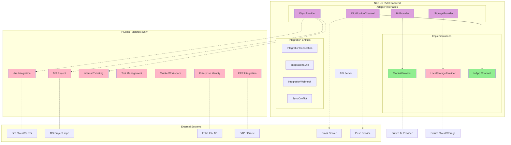

# Integration Architecture

---

## Current State: ALL INTEGRATIONS ARE MOCKED OR PLACEHOLDER

Every external system adapter in NEXUS PMO is either an interface without implementation, a mock provider, or a manifest-only plugin. No real external system connectivity is implemented.

---

## Adapter Interfaces

### ISyncProvider

| Aspect | Detail |
|--------|--------|
| **Namespace** | `NEXUS.Modules.Integrations.Application` |
| **File** | `Application/ISyncProvider.cs` |
| **Purpose** | Synchronization adapter for external systems (Jira, etc.) |
| **Implementation** | Not found |
| **Status** | Interface only; no real sync adapter |

### IAIProvider

| Aspect | Detail |
|--------|--------|
| **Namespace** | `NEXUS.Modules.AIPlanning.Application` |
| **File** | `Application/IAIProvider.cs` |
| **Purpose** | AI-powered plan generation and analysis |
| **Implementation** | `MockAIProvider` in `Infrastructure/MockAIProvider.cs` |
| **Status** | Mock implementation returns seeded responses |

### IStorageProvider

| Aspect | Detail |
|--------|--------|
| **Namespace** | `NEXUS.Modules.Documents.Application` |
| **File** | `Application/IStorageProvider.cs` |
| **Purpose** | File storage abstraction for document management |
| **Implementation** | `LocalStorageProvider` in `Infrastructure/LocalStorageProvider.cs` |
| **Status** | Placeholder (local filesystem, not production-ready) |

### INotificationChannel

| Aspect | Detail |
|--------|--------|
| **Namespace** | `NEXUS.Modules.Notifications.Application` |
| **File** | `Application/INotificationChannel.cs` |
| **Purpose** | Multi-channel notification delivery |
| **Sub-channels** | Email (placeholder), InApp (implemented), Push (placeholder) |
| **Status** | Interface only for Email/Push; InApp works via DB storage |

---

## External System Integrations

### Microsoft Project

| Aspect | Detail |
|--------|--------|
| **Type** | Plugin (`nexus.plugin.microsoft-project`) |
| **Status** | Manifest only |
| **Interface** | MPP file import/export (no MPP parsing library discovered) |
| **Plugin directory** | `plugins/microsoft-project/` -- `plugin.json` only |
| **Feature flag** | `microsoftProjectImport` |
| **Evidence** | `plugins/microsoft-project/plugin.json` |

### Jira

| Aspect | Detail |
|--------|--------|
| **Type** | Plugin (`nexus.plugin.jira-integration`) |
| **Status** | Manifest only |
| **Interface** | Bi-directional issue sync via `ISyncProvider` (no actual Jira REST client) |
| **Plugin directory** | `plugins/jira-integration/` -- `plugin.json` only |
| **Feature flag** | `jiraIntegration` |
| **Evidence** | `plugins/jira-integration/plugin.json` |

### Internal Ticketing

| Aspect | Detail |
|--------|--------|
| **Type** | Plugin (`nexus.plugin.internal-ticketing`) |
| **Status** | Manifest only |
| **Data model** | Uses `WorkItem` entity from WorkItems module (shared model) |
| **Plugin directory** | `plugins/internal-ticketing/` -- `plugin.json` only |
| **Feature flag** | `internalTicketing` |
| **Evidence** | `plugins/internal-ticketing/plugin.json` |

### Test Management

| Aspect | Detail |
|--------|--------|
| **Type** | Plugin (`nexus.plugin.test-management`) |
| **Status** | Manifest only |
| **Plugin directory** | `plugins/test-management/` -- `plugin.json` only |
| **Feature flag** | `testManagement` |
| **Evidence** | `plugins/test-management/plugin.json` |

### Mobile Workspace

| Aspect | Detail |
|--------|--------|
| **Type** | Plugin (`nexus.plugin.mobile-workspace`) |
| **Status** | Manifest only |
| **Plugin directory** | `plugins/mobile-workspace/` -- `plugin.json` only |
| **Feature flag** | `mobileWorkspace` |
| **Evidence** | `plugins/mobile-workspace/plugin.json` |

### Email Notifications

| Aspect | Detail |
|--------|--------|
| **Type** | Channel (`INotificationChannel`) |
| **Status** | Interface only |
| **Implementation** | No SMTP client, no email service discovered |
| **Evidence** | `INotificationChannel.cs` in Notifications module |

### Push Notifications

| Aspect | Detail |
|--------|--------|
| **Type** | Channel (`INotificationChannel`) |
| **Status** | Interface only |
| **Implementation** | No push notification service discovered |
| **Evidence** | `INotificationChannel.cs` in Notifications module |

### AI Provider

| Aspect | Detail |
|--------|--------|
| **Type** | Module (`NEXUS.Modules.AIPlanning`) |
| **Status** | Mock implementation |
| **Interface** | `IAIProvider` |
| **Implementation** | `MockAIProvider` -- generates seeded/random responses |
| **Evidence** | `AIPlanning/Infrastructure/MockAIProvider.cs` |

### Enterprise Identity (SSO/AD/LDAP)

| Aspect | Detail |
|--------|--------|
| **Type** | Plugin (`nexus.plugin.enterprise-identity`) |
| **Status** | Placeholder (v0.1.0) |
| **Plugin directory** | `plugins/enterprise-identity-placeholder/` -- `plugin.json` only |
| **Evidence** | `plugins/enterprise-identity-placeholder/plugin.json` |

### ERP Integration (SAP/Oracle)

| Aspect | Detail |
|--------|--------|
| **Type** | Plugin (`nexus.plugin.erp-integration`) |
| **Status** | Placeholder (v0.1.0) |
| **Plugin directory** | `plugins/erp-integration-placeholder/` -- `plugin.json` only |
| **Evidence** | `plugins/erp-integration-placeholder/plugin.json` |

---

## Integration Data Model

### IntegrationConnection
Tracks connection configuration for external systems:
- `ProviderType` -- discriminator for system type (Jira, MS Project, etc.)
- `Configuration` -- JSON with provider-specific settings
- `CredentialsEncrypted` -- stored encrypted credentials
- `IsActive`, `LastTestedAt` -- connection health

### IntegrationSync
Records synchronization history:
- `Status` -- Running, Completed, Failed, Partial
- `ItemsProcessed`, `ItemsFailed` -- sync outcome
- `ErrorLog` -- JSON error details

### IntegrationWebhook
Manages webhook subscriptions:
- `Url`, `Secret` -- webhook endpoint
- `Events` -- subscribed event types
- `IsActive`, `LastTriggeredAt` -- webhook status

### SyncConflict
Handles data conflicts during sync:
- `SourceData`, `TargetData` -- conflicting data snapshots
- `Resolution` -- SourceWins, TargetWins, Merged, Manual
- `ResolvedAt`, `ResolvedBy` -- resolution tracking

**Evidence:** `AppDbContext.cs:129-132`

---

## Integration Architecture Diagram



---

## Integration Health Tracking (Entity Structure)

The `IntegrationSync` entity supports tracking sync job health:

```
IntegrationSync
├── Status: Running / Completed / Failed / Partial
├── StartedAt, CompletedAt (duration tracking)
├── ItemsProcessed, ItemsFailed (volume tracking)
└── ErrorLog: JSON (error details & stack traces)
```

The `SyncConflict` entity supports conflict management:

```
SyncConflict
├── SourceData: JSON (external system data)
├── TargetData: JSON (NEXUS data)
├── Resolution: SourceWins / TargetWins / Merged / Manual
└── ResolvedAt, ResolvedBy (audit trail)
```

**Current state:** Entities exist and are stored in DB. No conflict resolution UI or sync job processor is implemented.
