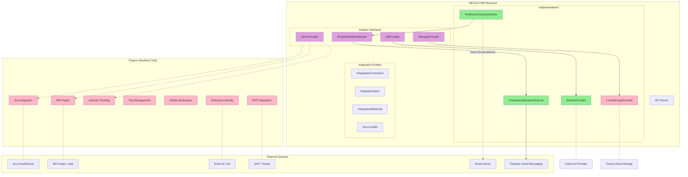

# Integration Architecture

---

## Current State: MOST INTEGRATIONS ARE MOCKED OR PLACEHOLDER

Most external-system adapters in NEXUS PMO are interfaces, mock providers, or manifest-only plugins. Directory Integration is implemented as a separate tenant-scoped capability for Microsoft Entra ID and secure LDAP. Its schema migration has been generated but still must be applied to the target database, and a real provider connection must be configured and verified before production use.

---

## Adapter Interfaces

### ISyncProvider

| Aspect | Detail |
|--------|--------|
| **Namespace** | `NEXUS.Modules.Integrations.Application` |
| **File** | `Application/ISyncProvider.cs` |
| **Purpose** | Synchronization adapter for external systems (Jira, etc.) |
| **Implementation** | Not found |
| **Status** | Interface only; no real sync adapter |

### IAIProvider

| Aspect | Detail |
|--------|--------|
| **Namespace** | `NEXUS.Modules.AIPlanning.Application` |
| **File** | `Application/IAIProvider.cs` |
| **Purpose** | AI-powered plan generation and analysis |
| **Implementation** | `MockAIProvider` in `Infrastructure/MockAIProvider.cs` |
| **Status** | Mock implementation returns seeded responses |

### IStorageProvider

| Aspect | Detail |
|--------|--------|
| **Namespace** | `NEXUS.Modules.Documents.Application` |
| **File** | `Application/IStorageProvider.cs` |
| **Purpose** | File storage abstraction for document management |
| **Implementation** | `LocalStorageProvider` in `Infrastructure/LocalStorageProvider.cs` |
| **Status** | Placeholder (local filesystem, not production-ready) |

### Notification Delivery Foundation

- `Notification` remains the canonical user-facing record. Its `IsInAppVisible` field controls Notification Center visibility; it does not encode a delivery channel.
- `NotificationService.SendAsync` persists the canonical notification and, when the authenticated recipient has Push enabled and Firebase is configured, a unique Pending `NotificationDelivery` in the same database save. It does not call a provider.
- `NotificationDeliveryWorker` claims bounded batches with an atomic status/lease update. Expired Processing leases are claimable again, including after a worker restart.
- A delivery owns one attempt per device token. Each device is tracked independently; transient failures use bounded exponential backoff, permanent failures stop, and unregistered/invalid registrations are deactivated.
- The worker stores provider outcomes and safe error summaries. FCM lock-screen title/body are generic; the payload carries only notification type and internal entity reference metadata.
- Active device tokens are globally unique by SHA-256 fingerprint. Re-registration reconciles stale ownership while keeping the previous owner row inactive for history.
- User preferences are scoped to the authenticated tenant/user and supported handover event types. In-App defaults on, Push defaults off, and Email preference can be stored while Email delivery remains unavailable.
- The current producers are project, program, and portfolio handovers. The migration does not enqueue historical notifications.

---

## External System Integrations

### Microsoft Project

| Aspect | Detail |
|--------|--------|
| **Type** | Project Planning format adapter |
| **Status** | MPP import is implemented; export is not provided by this adapter |
| **Interface** | `IPlanningImportProvider` returns a format-neutral planning import document |
| **Runtime project** | `apps/api/src/NEXUS.Modules.ProjectPlanning.MppAdapter` |
| **Parser** | `MPXJ.Net` parses Microsoft Project `.mpp` files and maps supported tasks, dates, dependencies, resources, assignments, and calendars |
| **Build dependency** | MPXJ.Net uses IKVM/Maven tooling to translate its Java library dependencies when the adapter is built |
| **EF boundary** | `NEXUS.Persistence` references the format-neutral ProjectPlanning module; the EF design-time project does not reference the MPP adapter |

### Jira

| Aspect | Detail |
|--------|--------|
| **Type** | Plugin (`nexus.plugin.jira-integration`) |
| **Status** | Manifest only |
| **Interface** | Bi-directional issue sync via `ISyncProvider` (no actual Jira REST client) |
| **Plugin directory** | `plugins/jira-integration/` -- `plugin.json` only |
| **Feature flag** | `jiraIntegration` |
| **Evidence** | `plugins/jira-integration/plugin.json` |

### Internal Ticketing

| Aspect | Detail |
|--------|--------|
| **Type** | Plugin (`nexus.plugin.internal-ticketing`) |
| **Status** | Manifest only |
| **Data model** | Uses `WorkItem` entity from WorkItems module (shared model) |
| **Plugin directory** | `plugins/internal-ticketing/` -- `plugin.json` only |
| **Feature flag** | `internalTicketing` |
| **Evidence** | `plugins/internal-ticketing/plugin.json` |

### Test Management

| Aspect | Detail |
|--------|--------|
| **Type** | Plugin (`nexus.plugin.test-management`) |
| **Status** | Manifest only |
| **Plugin directory** | `plugins/test-management/` -- `plugin.json` only |
| **Feature flag** | `testManagement` |
| **Evidence** | `plugins/test-management/plugin.json` |

### Mobile Workspace

| Aspect | Detail |
|--------|--------|
| **Type** | Plugin (`nexus.plugin.mobile-workspace`) |
| **Status** | Manifest only |
| **Plugin directory** | `plugins/mobile-workspace/` -- `plugin.json` only |
| **Feature flag** | `mobileWorkspace` |
| **Evidence** | `plugins/mobile-workspace/plugin.json` |

### Email Notifications

| Aspect | Detail |
|--------|--------|
| **Status** | Implemented in the shared Notifications delivery pipeline; runtime depends on SMTP configuration |
| **Implementation** | `NotificationService` creates a unique Email `NotificationDelivery` when a recipient has opted in and the provider is configured. `NotificationDeliveryWorker` claims it and `SmtpEmailNotificationChannel` sends it with bounded retries. |
| **Preferences** | Internal users can opt in per event from Account Notifications. Email defaults off; availability is reported from shared SMTP configuration. The worker rechecks the preference before sending. |
| **Configuration** | `EmailNotifications:Enabled`, `Host`, `Port`, `UseSsl`, optional paired `UserName`/`Password`, `FromAddress`, and optional `FromName`. Load secrets from the deployment secret manager. |
| **Limits** | SMTP acknowledgement loss can cause a retry to resend a message. Unique notification/channel deliveries and producer dispatch records prevent duplicate queueing but cannot guarantee exactly-once delivery. Meeting reminder email currently targets opted-in internal users; external attendee email remains disabled pending recipient-policy authorization. |
| **Operations guide** | [`docs/integrations/email-notifications.md`](../integrations/email-notifications.md) |

### Push Notifications

| Aspect | Detail |
|--------|--------|
| **Type** | Durable asynchronous channel (`IPushNotificationSender`) |
| **Status** | Implemented; runtime sending requires valid Firebase Admin configuration and user browser consent |
| **Implementation** | `NotificationDeliveryProcessor`, `NotificationDeliveryWorker`, and `FirebaseNotificationChannel` |
| **Failure handling** | Per-device result tracking, bounded retry/backoff, stale-token deactivation, and lease recovery |

### AI Provider

| Aspect | Detail |
|--------|--------|
| **Type** | Module (`NEXUS.Modules.AIPlanning`) |
| **Status** | Mock implementation |
| **Interface** | `IAIProvider` |
| **Implementation** | `MockAIProvider` -- generates seeded/random responses |
| **Evidence** | `AIPlanning/Infrastructure/MockAIProvider.cs` |

### Enterprise Identity (SSO/AD/LDAP)

| Aspect | Detail |
|--------|--------|
| **Type** | Plugin plus Directory Integration module |
| **Status** | SSO plugin remains a placeholder. Directory Integration provides directory read, selected-record synchronization, and optional user/resource provisioning; it does not implement login federation. |
| **Plugin directory** | `plugins/enterprise-identity-placeholder/` -- `plugin.json` only |
| **Implementation** | `NEXUS.Modules.Integrations` (`DirectoryIntegrationController`, Entra Graph and LDAPS providers) |

### Directory Integration (Microsoft Entra ID and Active Directory LDAP)

- Configuration, scope, mappings, provisioning policy, links, groups, and sync history are tenant-scoped.
- Entra uses Microsoft Graph app-only access. LDAP uses LDAPS only (ports 636/3269), with normal certificate validation. The API host must explicitly allowlist LDAP hosts through `DirectoryProviders:Ldap:AllowedHosts`; an empty allowlist denies all LDAP connections.
- Entra requires a tenant ID, app/client ID, and a server-side client-secret reference. The app registration must have Microsoft Graph application permissions `User.Read.All` and `GroupMember.Read.All`, with tenant admin consent.
- Credentials are referenced by alias and resolved from API-host configuration. The secret value is not accepted from the browser, returned by APIs, or stored in the directory connection row.
- Synchronization is manual: the operator previews current directory data, selects records and actions, and the API re-fetches and validates scope/actions before applying changes.
- Sync is bounded, audited, and non-destructive: user/group deletion is not performed; directory-owned role grants and organization relationships are tracked separately from manual assignments.
- Provisioning defaults are conservative. Resource creation is separately configurable; no automatic directory password import is performed.
- Permission keys are `Directory.View`, `Directory.Manage`, `Directory.TestConnection`, `Directory.PreviewSync`, `Directory.ExecuteSync`, `Directory.ManageMappings`, and `Directory.ManageProvisioningPolicy`.
- API secret configuration path: `DirectorySecrets:{tenantId}:{connectionId}:{reference}`. For environment variables, replace colons with double underscores (`DirectorySecrets__{tenantId}__{connectionId}__{reference}`). Keep referenced values in the API host's secret store; never put them in the React app, source control, or a directory-connection request.
- LDAP host allowlist path: `DirectoryProviders:Ldap:AllowedHosts`; environment-variable form: `DirectoryProviders__Ldap__AllowedHosts__0` (add further numbered entries as needed).
- Migration `20261011205628_AddDirectoryIntegration` creates only the eleven `Directory*` tables. It has been generated and compiled, but was not applied to a database in this task.

### ERP Integration (SAP/Oracle)

| Aspect | Detail |
|--------|--------|
| **Type** | Plugin (`nexus.plugin.erp-integration`) |
| **Status** | Placeholder (v0.1.0) |
| **Plugin directory** | `plugins/erp-integration-placeholder/` -- `plugin.json` only |
| **Evidence** | `plugins/erp-integration-placeholder/plugin.json` |

---

## Integration Data Model

### IntegrationConnection
Tracks connection configuration for external systems:
- `ProviderType` -- discriminator for system type (Jira, MS Project, etc.)
- `Configuration` -- JSON with provider-specific settings
- `CredentialsEncrypted` -- stored encrypted credentials
- `IsActive`, `LastTestedAt` -- connection health

### IntegrationSync
Records synchronization history:
- `Status` -- Running, Completed, Failed, Partial
- `ItemsProcessed`, `ItemsFailed` -- sync outcome
- `ErrorLog` -- JSON error details

### IntegrationWebhook
Manages webhook subscriptions:
- `Url`, `Secret` -- webhook endpoint
- `Events` -- subscribed event types
- `IsActive`, `LastTriggeredAt` -- webhook status

### SyncConflict
Handles data conflicts during sync:
- `SourceData`, `TargetData` -- conflicting data snapshots
- `Resolution` -- SourceWins, TargetWins, Merged, Manual
- `ResolvedAt`, `ResolvedBy` -- resolution tracking

**Evidence:** `AppDbContext.cs:129-132`

---

## Integration Architecture Diagram



---

## Integration Health Tracking (Entity Structure)

The `IntegrationSync` entity supports tracking sync job health:

```
IntegrationSync
├── Status: Running / Completed / Failed / Partial
├── StartedAt, CompletedAt (duration tracking)
├── ItemsProcessed, ItemsFailed (volume tracking)
└── ErrorLog: JSON (error details & stack traces)
```

The `SyncConflict` entity supports conflict management:

```
SyncConflict
├── SourceData: JSON (external system data)
├── TargetData: JSON (NEXUS data)
├── Resolution: SourceWins / TargetWins / Merged / Manual
└── ResolvedAt, ResolvedBy (audit trail)
```

**Current state:** Entities exist and are stored in DB. No conflict resolution UI or sync job processor is implemented.
