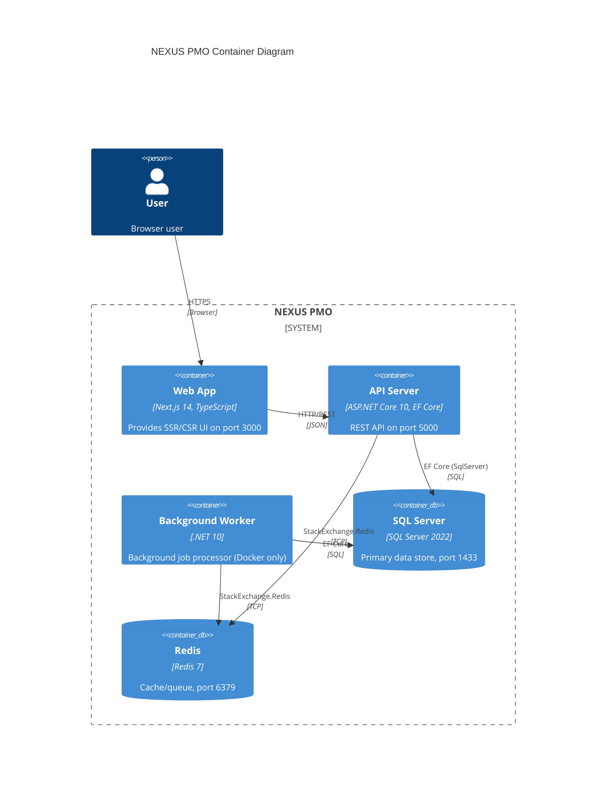
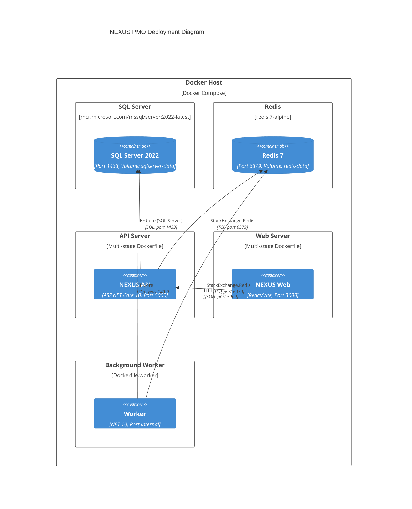

# NEXUS PMO Architecture Reference

> Historical record: Next.js references below describe the retired frontend and are kept only to preserve the original decision or implementation history. The supported frontend is apps/web-react (React, Vite, and React Router); these references are not build, deployment, agent, or audit targets.
>
> The July 2026 maturity, seed, and migration statements are historical snapshots. Current identity and security behavior is documented in `SECURITY-ARCHITECTURE.md`, `AUTHENTICATION-AND-IDENTITY.md`, and `multi-tenancy.md`; the documented EF Core database workflow is in `docs/development/ef-core-database-workflow.md`.

## 1. Document Metadata

| Attribute | Value |
|-----------|-------|
| **Product name** | NEXUS PMO |
| **Document version** | 1.0 |
| **Last updated** | 30 July 2026 |
| **Architecture status** | Foundation / In Development |
| **Document owner** | PMO Architecture Team (placeholder) |
| **Review status** | Draft |

**Evidence:** Product name, tagline, and version confirmed in `README.md:2` and `apps/web/src/lib/constants.ts:1-4`.

---

## 2. Executive Architecture Summary

NEXUS PMO is an **Enterprise Project Portfolio Management Platform** whose main business purpose is to connect portfolio management, project planning, execution, governance, resources, costs, workflows, notifications, AI planning, and integrations into a unified system.

- **Primary users:** Executives, Portfolio Managers, Project Managers, Team Members, PMO Administrators, Finance Controllers, Resource Managers (verifiable via `SeedDataProvider.cs` demo accounts and `permissions.ts` role definitions)
- **Core architectural style:** Modular Monolith with Clean Architecture (verifiable via ADR-001, solution structure with 22 .NET projects in a single `.slnx`, and `Program.cs` registering 19 modules via `IServiceCollection` extension methods)
- **Historical maturity snapshot (July 2026):** The original baseline described mock UI data, `EnsureCreatedAsync`, and eight demo accounts. It is superseded: the current source uses EF migrations and a secure single-Admin Development bootstrap; see the current security and database delivery reports.

**Evidence:**
- `README.md:5-8` -- Product description and architecture overview
- `NEXUS.slnx` -- 22 project references
- `Program.cs:99-117` -- 19 module registrations
- `SeedDataProvider.cs` -- deterministic Development seed; fresh identity bootstrap creates the protected Admin account and role templates
- `mock-data.ts` -- 633 lines of mock interfaces and arrays

---

## 3. System Context

NEXUS PMO interacts with the following external actors and systems:

```mermaid
C4Context
  title System Context Diagram - NEXUS PMO

  Person(exec, "Executive", "Portfolio oversight, strategic decisions")
  Person(pm, "Project Manager", "Day-to-day project execution")
  Person(tm, "Team Member", "Task execution, time tracking")
  Person(pmo, "PMO Admin", "Governance, standards, reporting")
  Person(fin, "Finance Controller", "Budget/cost management")
  Person(rm, "Resource Manager", "Resource allocation, capacity")

  System_Boundary(nexus, "NEXUS PMO") {
    System(web, "Web App", "Next.js 14 SPA/SSR")
    System(api, "API Server", "ASP.NET Core 10")
    System_db(db, "Database", "SQL Server 2022")
    System(cache, "Cache", "Redis 7")
  }

  System_Ext(msproject, "MS Project", "MPP import/export")
  System_Ext(jira, "Jira", "Issue/task sync")
  System_Ext(ticketing, "Internal Ticketing", "Helpdesk system")
  System_Ext(ai, "AI Provider", "Plan generation, analysis")
  System_Ext(email, "Email Server", "Email notifications (placeholder)")
  System_Ext(push, "Push Notification", "Firebase Cloud Messaging (async; deployment configuration required)")
  System_Ext(storage, "File Storage", "Document storage (local)")
  System_Ext(erp, "ERP System", "SAP/Oracle integration (placeholder)")
  System_Ext(identity, "Enterprise Identity", "AD/LDAP/SAML (placeholder)")

  Rel(exec, web, "Uses")
  Rel(pm, web, "Uses")
  Rel(tm, web, "Uses")
  Rel(pmo, web, "Uses")
  Rel(fin, web, "Uses")
  Rel(rm, web, "Uses")

  Rel(web, api, "HTTP/REST", "JSON")
  Rel(api, db, "EF Core", "SQL")
  Rel(api, cache, "StackExchange.Redis")

  Rel(api, msproject, "Import/Export", "Placeholder")
  Rel(api, jira, "REST API", "Placeholder")
  Rel(api, ticketing, "Internal", "Placeholder")
  Rel(api, ai, "HTTP", "Placeholder")
  Rel(api, email, "Email delivery", "Deferred")
  Rel(api, push, "Durable asynchronous delivery", "FCM")
  Rel(api, storage, "File I/O", "LocalStorage Provider")
  Rel(api, erp, "REST/SOAP", "Placeholder")
  Rel(api, identity, "LDAP/SAML/OIDC", "Placeholder")
```

**Evidence:**
- End-user role examples describe role templates, not shared-password login accounts; fresh Development identity bootstrap creates the protected Admin account.
- MS Project, Jira, Ticketing: plugins/jira-integration/plugin.json, plugins/microsoft-project/plugin.json, plugins/internal-ticketing/plugin.json (all manifest-based placeholders)
- AI provider: `Program.cs:117` registers AIPlanning module; `docs/architecture/module-catalogue.md:525-546` documents AI planning entities
- Notifications: `NotificationService`, durable `NotificationDelivery` rows, a leased background worker, per-device attempts, and an FCM adapter are implemented; Email remains deferred.
- File storage: `IStorageProvider` interface documented, `LocalStorageProvider` placeholder
- ERP: plugins/erp-integration-placeholder/plugin.json
- Enterprise identity: plugins/enterprise-identity-placeholder/plugin.json

---

## 4. Technology Stack

### Frontend (verifiable from `apps/web/package.json`)

| Technology | Version | Use |
|------------|---------|-----|
| Next.js | ^14.2.0 | App Router, SSR/SSR hybrid |
| React | ^18.3.0 | UI library |
| React DOM | ^18.3.0 | DOM rendering |
| TypeScript | ^5.5.0 | Type safety |
| Tailwind CSS | ^3.4.0 | Utility-first styling |
| tailwindcss-animate | ^1.0.7 | Animation utilities |
| class-variance-authority | ^0.7.0 | Component variants |
| clsx | ^2.1.0 | Class name utilities |
| tailwind-merge | ^2.4.0 | Class merging |
| Radix UI (18 primitives) | ^1.1.x-2.1.x | Accessible UI primitives |
| shadcn/ui | (via Radix) | 26 UI components in `components/ui/` |
| TanStack React Query | ^5.50.0 | Server state management |
| TanStack React Table | ^8.19.0 | Data tables |
| Recharts | ^2.12.0 | Charts and visualizations |
| React Hook Form | ^7.52.0 | Form management |
| @hookform/resolvers | ^3.9.0 | Form validation resolvers |
| Zod | ^3.23.0 | Schema validation |
| next-intl | ^3.16.0 | Internationalization (EN + AR) |
| next-themes | ^0.3.0 | Dark/light mode |
| cmdk | ^1.0.0 | Command palette |
| Lucide React | ^0.400.0 | Icon library |
| date-fns | ^3.6.0 | Date utilities |
| ESLint | ^8.57.0 | Linting |
| eslint-config-next | ^14.2.0 | Next.js ESLint config |

### Backend (verifiable from `.csproj` files and `Program.cs`)

| Technology | Version | Verifiable From |
|------------|---------|-----------------|
| .NET | 10.0 LTS (net10.0) | All 22 `.csproj` files use `<TargetFramework>net10.0</TargetFramework>` |
| ASP.NET Core | 10.0 | NEXUS.Api.csproj |
| Entity Framework Core | 10.0.10 | NEXUS.Persistence.csproj |
| SQL Server EF Core provider | 10.0.10 | NEXUS.Persistence.csproj |
| JWT Bearer Auth | 10.0.10 | NEXUS.Api.csproj + Program.cs:59-73 |
| Swagger / OpenAPI (Swashbuckle) | 6.9.0 | NEXUS.Api.csproj + Program.cs:36-57 |
| FluentValidation | 11.11.0 | Referenced in module .csproj files |
| MediatR | 12.2.0 | NEXUS.SharedKernel.csproj + BaseDomainEvent.cs |
| Serilog | 10.0.0 | NEXUS.Api.csproj (configured, not verified in Program.cs) |
| BCrypt.Net | 4.0.3 | SeedDataProvider.cs uses `BCrypt.Net.BCrypt.HashPassword` |

**NOTE:** Dockerfiles use `.NET 10` images matching the `net10.0` TFM. The mismatch documented in ADR-005 has been resolved.

### Infrastructure

| Component | Details | Verifiable From |
|-----------|---------|-----------------|
| SQL Server 2022 | mcr.microsoft.com/mssql/server:2022-latest | docker-compose.yml |
| Redis | redis:7-alpine | docker-compose.yml |
| Docker Compose | 5 services | docker-compose.yml |
| Packaging | Standalone output for Next.js | Dockerfile uses `.next/standalone` |

### Localization
- next-intl with English (`en.json`) and Arabic (`ar.json`) locale files
- Verifiable: `apps/web/src/messages/en.json`, `apps/web/src/messages/ar.json`, `middleware.ts`, `i18n.ts`

### CI/CD
- **Not configured.** README.md mentions "GitHub Actions (configured)" at line 173 but no `.github/workflows` directory was found in the repository (not verified).

---

## 5. Repository Structure

```
C:\Projects\pmo/
├── apps/
│   ├── api/                              # .NET 10 ASP.NET Core solution
│   │   ├── NEXUS.slnx                    # Solution file (22 projects)
│   │   ├── Dockerfile                    # Multi-stage build for API
│   │   ├── Dockerfile.worker             # Multi-stage build for background worker
│   │   └── src/
│   │       ├── NEXUS.Api/                # API host: Program.cs, Controllers, appsettings
│   │       ├── NEXUS.SharedKernel/       # BaseEntity, BaseDomainEvent, interfaces, value objects
│   │       ├── NEXUS.Persistence/        # EF Core DbContext, entity configs, seed data, migrations
│   │       ├── NEXUS.Modules.Identity/       # Auth, users, roles, permissions
│   │       ├── NEXUS.Modules.Organization/   # Org structure, BUs, departments, teams
│   │       ├── NEXUS.Modules.Portfolio/      # Portfolios, programs, strategic objectives
│   │       ├── NEXUS.Modules.ProjectManagement/  # Projects, milestones, baselines, WBS
│   │       ├── NEXUS.Modules.WorkItems/         # Tasks, bugs, stories, epics
│   │       ├── NEXUS.Modules.ResourceManagement/ # Resources, skills, allocations, rate cards
│   │       ├── NEXUS.Modules.CostManagement/    # Budgets, cost entries, invoices
│   │       ├── NEXUS.Modules.RiskManagement/    # Risk register, mitigations, contingencies
│   │       ├── NEXUS.Modules.IssueManagement/   # Issue tracking, actions
│   │       ├── NEXUS.Modules.Meetings/          # Meetings, agendas, minutes, actions
│   │       ├── NEXUS.Modules.WorkflowEngine/    # Workflow templates, instances, transitions
│   │       ├── NEXUS.Modules.Approvals/         # Approval requests, actions, delegations
│   │       ├── NEXUS.Modules.Notifications/     # Canonical notifications, preferences, durable Push delivery
│   │       ├── NEXUS.Modules.Documents/         # Document metadata, versions, reviews
│   │       ├── NEXUS.Modules.Reporting/         # Report definitions, schedules, exports
│   │       ├── NEXUS.Modules.Audit/             # Audit entries, activity log
│   │       ├── NEXUS.Modules.Integrations/      # Integration connections, sync, webhooks
│   │       ├── NEXUS.Modules.PluginManagement/  # Plugin registry, tenant activation
│   │       └── NEXUS.Modules.AIPlanning/        # AI plan requests, responses
│   └── web/                              # Next.js 14 frontend
│       ├── Dockerfile                    # Multi-stage with standalone output
│       └── src/
│           ├── app/                      # App Router: [locale]/(dashboard)/ pages (57 pages)
│           ├── components/
│           │   ├── layout/               # Sidebar, Header, Breadcrumbs, PageHeader
│           │   └── ui/                   # 26 shadcn/ui components buttons, cards, dialogs, etc.
│           ├── hooks/                    # Custom React hooks
│           ├── lib/                      # Utilities, mock-data, navigation, permissions, constants
│           ├── messages/                 # en.json, ar.json (i18n)
│           ├── i18n.ts                   # next-intl configuration
│           └── middleware.ts             # next-intl routing middleware
├── docs/                                # Architecture, API, decisions, domain, development, UI docs
├── modules/                             # 20 module interface documentation folders
├── packages/                            # Shared TS types, UI, config, localization, API client
│   ├── shared-types/                    # Shared TypeScript type definitions
│   ├── ui/                              # Shared UI components
│   ├── config/                          # Shared configuration
│   ├── localization/                    # i18n resources
│   └── api-client/                      # API client library
├── plugins/                             # 7 plugin manifest directories (empty of code)
│   ├── jira-integration/                # plugin.json manifest only
│   ├── microsoft-project/               # plugin.json manifest only
│   ├── internal-ticketing/              # plugin.json manifest only
│   ├── test-management/                 # plugin.json manifest only
│   ├── mobile-workspace/                # plugin.json manifest only
│   ├── enterprise-identity-placeholder/ # plugin.json manifest only
│   └── erp-integration-placeholder/     # plugin.json manifest only
├── services/background-worker/          # Empty directory (placeholder)
├── apps/mobile-placeholder/             # Empty directory (placeholder)
├── scripts/                             # Development/build scripts
├── docker-compose.yml                   # 5 services (postgres, redis, api, web, worker)
└── package.json                         # Root workspace scripts
```

**Evidence:** Verified by reading `apps/api/src/` directories, `apps/web/src/` directory tree, `plugins/` directory listing, `packages/` listing, `services/background-worker/` (empty), `apps/mobile-placeholder/` (empty), `modules/` (20 subdirectories), `docker-compose.yml`.

---

## 6. Architectural Style

### Modular Monolith

- **22 .NET projects in a single solution file (`NEXUS.slnx`)** -- verifiable. One API host project (`NEXUS.Api`), 19 module projects, 1 shared kernel, 1 persistence project.
- **Single deployment** -- all modules compile into one ASP.NET Core application. Verifiable: `NEXUS.Api.csproj` references all module projects.
- **Shared database** -- `AppDbContext` contains 60+ `DbSet` properties covering all modules.

### Clean Architecture

Each module follows the Clean Architecture pattern with four layers:

```
NEXUS.Modules.{Name}/
├── Domain/           # Entities, value objects, domain events
├── Application/      # Service interfaces and implementations
├── Api/              # Controllers, route definitions
├── Infrastructure/   # Repository implementations, external adapters
└── ModuleRegistration/  # DI extension methods
```

- Verifiable: Every module project follows this structure (e.g., `NEXUS.Modules.Identity` has `Domain/`, `Application/`, `Api/`, `Infrastructure/`, `ModuleRegistration/`).

### Dependency Inversion

- Each module exposes a static `IServiceCollection` extension method (e.g., `AddIdentityModule()`). All 19 are registered in `Program.cs:99-117`.

### Internal Domain Events

- `BaseDomainEvent` class exists in `NEXUS.SharedKernel` inheriting from MediatR's `INotification` -- verifiable structurally.
- `IAggregateRoot` interface defines `DomainEvents` collection -- verifiable structurally.
- **No event bus implementation or domain event handler verified in the codebase.** No MediatR pipeline behaviors or `INotificationHandler<T>` implementations were discovered. This is an intended pattern that is structurally prepared but not verified as functional.

### Application Contracts

- Each module defines service interfaces in its `Application/` layer (e.g., `IAuthenticationService`, `IProjectService`, `IWorkItemService`). Verifiable via module-catalogue.md and module project structures.

### Infrastructure Adapters

- Repository pattern for data access: `IUserRepository`/`UserRepository` pattern verified in `IdentityModuleRegistration.cs:12`.
- Entity Framework Core configurations in `NEXUS.Persistence/Configurations/`.

### Plugin Extension Points

- Plugin manifests (`plugin.json`) define `navigationContributions`, `dashboardWidgetContributions`, `eventSubscriptions`, `featureFlags` -- verifiable in all 7 plugin directories.
- **Not verified as runtime functional:** No runtime plugin loading, assembly scanning, or `IPlugin` interface implementation discovered. Plugin framework is manifest-based only (placeholder).

### Feature Flags

- Defined in `plugin.json` `featureFlags` arrays for each plugin (e.g., `"jiraIntegration"`, `"microsoftProjectImport"`).
- **Not verified in application code.** No code reading these flags was found.

### Tenant Isolation

- `ITenantEntity` interface defines `TenantId` property -- verifiable.
- `BaseEntity` implements `ITenantEntity` and `ISoftDeletable` -- verifiable.
- Global query filters in `AppDbContext:167-169` apply `e.TenantId == GetCurrentTenantId()` to all `ITenantEntity` types -- verifiable.
- `GetCurrentTenantId()` at `AppDbContext:190-193` returns `Guid.Empty` -- structurally present but **NOT actively enforcing tenant isolation** (returns zero GUID, no tenant resolution from JWT context).

### Architectural Rules Intended But Not Enforced

| Rule | Intended | Currently Enforced? |
|------|----------|---------------------|
| No direct cross-module dependencies | Modules communicate via contracts only | Structurally separated into folders but C# projects all reference each other via `.csproj`; code review discipline required |
| Domain events for async communication | `BaseDomainEvent` + MediatR pipeline | No event handlers found; pattern is structural only |
| Plugin runtime isolation | Assembly scanning + `AssemblyLoadContext` | No runtime loader; manifests only |
| Tenant resolution from JWT | `GetCurrentTenantId()` should read JWT claim | Returns `Guid.Empty` -- not resolved |
| CQRS via MediatR | Commands and queries | `MediatR` is a package dependency but no `IRequest`/`IRequestHandler` usages verified |
| CORS restricted to known origins | `WithOrigins("http://localhost:3000", ...)` | Configured but allows AnyHeader/AnyMethod |

**Evidence:** All architectural claims in this section are cross-referenced from `docs/architecture/README.md`, `docs/architecture/module-catalogue.md`, `docs/decisions/adr-001-modular-monolith.md`, `Program.cs`, `AppDbContext.cs`, `BaseEntity.cs`, `BaseDomainEvent.cs`, `ITenantEntity.cs`, `ISoftDeletable.cs`, `IAggregateRoot.cs`, and directory structures.

---

## 7. Application Components

| Component | Technology | Port | Start Command | Status |
|-----------|-----------|------|---------------|--------|
| Web App (frontend) | Next.js 14 | 3000 | `npm run dev:web` or `docker compose up web` | Implemented |
| API (.NET) | ASP.NET Core 10 | 5000 | `npm run dev:api` or `docker compose up api` | Implemented |
| Background Worker | .NET 10 | N/A (internal) | `docker compose up worker` (Docker only) | Structurally present (Dockerfile, empty service directory) |
| SQL Server | 2022-latest | 1433 | `docker compose up sqlserver` | Implemented |
| Redis | 7-alpine | 6379 | `docker compose up redis` | Configured |
| Mobile | (none) | N/A | N/A | Empty directory (`apps/mobile-placeholder/`) |



**Evidence:** `docker-compose.yml` defines all 5 services. `package.json:7-8` defines `dev:web` as `cd apps/web && npm run dev`. `package.json:9` defines `dev:api` as `cd apps/api && dotnet run`. `Dockerfile.worker:17` shows `--worker-mode` entrypoint. `apps/mobile-placeholder/` is empty.

---

## 8. Backend Module Catalogue

All 19 modules. Evidence cross-referenced from `docs/architecture/module-catalogue.md`, `docs/domain/entities.md`, `Program.cs`, `AppDbContext.cs`, and `SeedDataProvider.cs`.

### 8.1 Identity
| Attribute | Detail |
|-----------|--------|
| **Responsibility** | Authentication, authorization, user and role management, and JWT issuance |
| **Entities** | User, Role, Permission, UserRole, UserSession |
| **Services** | IAuthenticationService (DemoAuthService), IUserRepository (UserRepository) |
| **API endpoints** | POST /api/auth/login, GET /api/auth/me, POST /api/auth/logout; the retained switch-role compatibility route returns current user state and does not change roles |
| **Events** | UserLoggedIn, UserRoleChanged (documented, not verified in code) |
| **Dependencies** | SharedKernel |
| **Maturity** | Implemented in source; live permission/database verification is tracked in the current permission closure report |

### 8.2 Organization
| **Responsibility** | Company structure: business units, departments, teams, locations, working calendars |
| **Entities** | Organization, BusinessUnit, Department, Team, Location, WorkingCalendar, Holiday, Lookup, Currency, CostCentre |
| **API endpoints** | GET /api/organization, /api/business-units, /api/departments, /api/teams, /api/locations, /api/lookups |
| **Maturity** | Implemented (entities verified in AppDbContext, services in module-catalogue) |

### 8.3 Portfolio
| **Responsibility** | Portfolio and program management, strategic alignment, health tracking, budget oversight |
| **Entities** | Portfolio, Program, StrategicObjective, PortfolioHealth, PortfolioBudget, PortfolioRisk |
| **API endpoints** | GET/POST/PUT/DELETE /api/portfolios, /api/programs |
| **Dependencies** | Identity, Organization |
| **Maturity** | Implemented (entities verified, seed data creates 4 portfolios and 7 programs) |

### 8.4 Project Management
| **Responsibility** | Full project lifecycle: milestones, baselines, deliverables, phases, WBS, EVM, status reporting |
| **Entities** | Project, ProjectMember, ProjectPhase, ProjectStakeholder, ProjectSchedule, WBS, Milestone, Deliverable, Baseline, ProjectStatusReport |
| **Services** | IProjectService, IMilestoneService, IBaselineService |
| **API endpoints** | GET/POST/PUT/DELETE /api/projects, milestones, baselines, status-reports |
| **Dependencies** | Identity, Portfolio |
| **Maturity** | Implemented (24 projects seeded with EVM data, entities verified) |

### 8.5 Work Items
| **Responsibility** | Agile work items: tasks, bugs, stories, epics, features, internal/external source tracking |
| **Entities** | WorkItem, WorkItemAssignment |
| **Services** | IWorkItemService |
| **API endpoints** | GET/POST/PUT/DELETE /api/work-items |
| **Dependencies** | Project Management |
| **Maturity** | Implemented (320 work items seeded, entity in AppDbContext) |

### 8.6 Resource Management
| **Responsibility** | Resource planning, allocations, capacity, skills, rate cards, contracts, vendors |
| **Entities** | Resource, ResourceSkill, Skill, ResourceAllocation, ResourceRequest, RateCard, Contract, ResourceCalendar, Vendor |
| **Services** | IResourceService, IAllocationService |
| **API endpoints** | GET/POST/PUT /api/resources, /api/allocations, availability checks |
| **Dependencies** | Identity, Organization |
| **Maturity** | Implemented (120 resources seeded, entities verified) |

### 8.7 Cost Management
| **Responsibility** | Financial management: budgets, cost entries, invoices, purchase commitments, EVM integration |
| **Entities** | Budget, CostEntry, CostCategory, CostApproval, Invoice, PurchaseCommitment |
| **API endpoints** | GET/POST /api/budgets, /api/costs, /api/invoices |
| **Dependencies** | Project Management, Identity |
| **Maturity** | Implemented (24 budgets + 50 cost entries seeded) |

### 8.8 Risk Management
| **Responsibility** | Risk register, impact/likelihood assessment, mitigation, contingency |
| **Entities** | Risk, RiskCategory, RiskAction, RiskFollowUp, RiskFollowUpUpdate (legacy RiskMitigation/RiskContingency retained for compatibility) |
| **API endpoints** | GET/POST/PUT /api/risks, status transition, project filter, actions, follow-up, and follow-up updates |
| **Dependencies** | Project Management, Identity |
| **Maturity** | Workflow v1 implemented; legacy mitigation/target fields migrated into actions |

### 8.9 Issue Management
| **Responsibility** | Issue tracking, severity/priority, resolution, action items |
| **Entities** | Issue, IssueCategory, IssueAction |
| **API endpoints** | GET/POST/PUT/DELETE /api/issues |
| **Dependencies** | Project Management, Identity |
| **Maturity** | Implemented (17 issues seeded) |

### 8.10 Meetings
| **Responsibility** | Meeting scheduling, agendas, participants, minutes, action items; supports virtual/in-person/hybrid |
| **Entities** | Meeting, MeetingAgenda, MeetingParticipant, MeetingMinutes, MeetingAction |
| **API endpoints** | GET/POST/PUT/DELETE /api/meetings, /api/meetings/{id}/actions |
| **Dependencies** | Project Management, Identity |
| **Maturity** | Implemented (22 meetings seeded) |

### 8.11 Workflow Engine
| **Responsibility** | Configurable workflow state machines, transitions, conditions, SLA, escalation |
| **Entities** | WorkflowTemplate, WorkflowVersion, WorkflowInstance, WorkflowState, WorkflowTransition, WorkflowCondition, SLA, Escalation |
| **API endpoints** | GET/POST/PUT /api/workflows, /api/workflows/{id}/instances |
| **Dependencies** | Identity |
| **Maturity** | Partial (entities verified in AppDbContext; workflow execution logic not verified) |

### 8.12 Approvals
| **Responsibility** | Multi-level approval requests, delegation, entities: budgets, contracts, scope changes |
| **Entities** | ApprovalRequest, ApprovalAction, Delegation |
| **API endpoints** | GET/POST /api/approvals, approve/reject/delegate actions |
| **Dependencies** | Identity, Workflow Engine |
| **Maturity** | Implemented (18 approval requests seeded) |

### 8.13 Notifications
| **Responsibility** | Canonical in-app notifications, per-user channel preferences, durable asynchronous Push delivery; Email deferred |
| **Entities** | Notification, NotificationDelivery, NotificationDeliveryAttempt, UserDeviceToken, NotificationTemplate, NotificationPreference, NotificationDigest |
| **API endpoints** | GET /api/notifications, unread-count, mark-read/read-all, preferences, device register/deactivate |
| **Dependencies** | Identity |
| **Maturity** | In-App and asynchronous Push foundation implemented; runtime FCM requires valid server configuration and browser consent; Email is deferred |

### 8.14 Documents
| **Responsibility** | Document metadata, versioning, categories, reviews, file storage |
| **Entities** | Document, DocumentVersion, DocumentCategory, DocumentReview |
| **API endpoints** | GET/POST/DELETE /api/documents, upload/download |
| **Dependencies** | Project Management, Identity |
| **Maturity** | Implemented (entities verified; storage is LocalStorageProvider placeholder) |

### 8.15 Reporting
| **Responsibility** | Report definitions, scheduling, export (PDF/Excel/CSV) |
| **Entities** | ReportDefinition, ReportSchedule, ReportExport |
| **API endpoints** | GET/POST /api/reports, generate, schedule, exports |
| **Dependencies** | All modules (data sources) |
| **Maturity** | Implemented (entities verified) |

### 8.16 Audit
| **Responsibility** | Immutable audit trail, entity change tracking, activity log |
| **Entities** | AuditEntry, AuditActivity |
| **API endpoints** | GET /api/audit (tenant-wide), GET /api/projects/{projectId}/audit and /facets (project trail); read-only, `Audit.View` |
| **Dependencies** | SharedKernel (IAuditable), Persistence (project scope provider, append-only guard) |
| **Maturity** | Implemented; project trail migration created but not applied. See `docs/modules/AUDIT-TRAIL.md` |

### 8.17 Integrations
| **Responsibility** | External system connection management, sync jobs, webhooks, conflict resolution |
| **Entities** | IntegrationConnection, IntegrationSync, IntegrationWebhook, SyncConflict |
| **API endpoints** | GET/POST/PUT/DELETE /api/integrations, trigger sync, webhooks |
| **Dependencies** | Identity |
| **Maturity** | Partial (entities verified; no real sync adapters implemented) |

### 8.18 Plugin Management
| **Responsibility** | Plugin registry, lifecycle, tenant activation, dependency resolution |
| **Entities** | Plugin, TenantPlugin, PluginDependency |
| **API endpoints** | GET/POST/DELETE /api/plugins, install/activate/deactivate |
| **Dependencies** | Identity |
| **Maturity** | Partial (entities verified; no runtime plugin loading code verified) |

### 8.19 AI Planning
| **Responsibility** | AI-powered plan generation, analysis, risk prediction (mock/provider-abstracted) |
| **Entities** | AIPlanRequest, AIPlanResponse |
| **API endpoints** | POST /api/ai/generate-plan, /review-plan, /analyze-risk, GET /api/ai/requests |
| **Dependencies** | Project Management, Resource Management |
| **Maturity** | Partial (entities verified; AI provider adapter is placeholder/mock) |

---

## 9. Frontend Architecture

### Next.js App Router
- **App Router** with `[locale]` route group for internationalization (verifiable from `apps/web/src/app/` directory structure).
- **Root layout** (`apps/web/src/app/layout.tsx`): Sets up font (Inter), metadata, `<Providers>` wrapping.
- **Locale layout** (`apps/web/src/app/[locale]/layout.tsx`): Wraps with `NextIntlClientProvider`.
- **Dashboard layout group** `(dashboard)` at `apps/web/src/app/[locale]/(dashboard)/layout.tsx`: Client component with `Sidebar`, `Header`, `Breadcrumbs`, and `CommandDialog` (⌘K palette).
- Root page at `apps/web/src/app/page.tsx` -- likely redirects to `/[locale]/home`.

### Layout Components (4 total)
| Component | File | Purpose |
|-----------|------|---------|
| Sidebar | `components/layout/Sidebar.tsx` | Navigation sidebar with collapsible state |
| Header | `components/layout/Header.tsx` | Top header bar with search trigger |
| Breadcrumbs | `components/layout/Breadcrumbs.tsx` | Breadcrumb trail |
| PageHeader | `components/layout/PageHeader.tsx` | Page title and actions header |

### UI Components (26 total)
All in `components/ui/`: avatar, badge, button, card, checkbox, collapsible, command, dialog, dropdown-menu, form, input, label, popover, progress, scroll-area, select, separator, sheet, skeleton, switch, table, tabs, textarea, toast, toaster, tooltip.

### Pages (57 total)
Verified via glob: 57 `page.tsx` files across the `[locale]/(dashboard)/` route group covering: administration (8), ai-workspace (3), costs (5), documents (1), home (1), integrations (1), meetings (3), my-work (4), notifications (1), plugins (1), portfolios (3), projects (6), reports (5), resources (4), risks-issues (4), security-audit (3), test-management (1), tickets (1), workflows (1), plus root page.tsx.

### Mock Data
- `apps/web/src/lib/mock-data.ts` (633 lines) defines TypeScript interfaces for Portfolio, Project, User, Resource, WorkItem, etc. with embedded mock arrays.
- First line: `// @ts-nocheck - Mock data file; will be replaced by API calls`
- Mock data is embedded directly in client components, not fetched from API.

### Navigation Configuration
- `apps/web/src/lib/navigation.ts` (230 lines) defines 20 top-level nav items with hierarchies, icons, required permissions, and required plugins.

### Permission Constants
- `apps/web/src/lib/permissions.ts` (166 lines) defines 15 permission categories with granular actions, 13 role definitions, and helper functions.

### i18n Setup
- next-intl with `middleware.ts`, `i18n.ts`, `en.json`, `ar.json`.
- Supported locales: `["en", "ar"]` (verifiable in `constants.ts:7`).
- RTL support via next-intl (Arabic locale file exists; RTL layout not explicitly verified in this scan but next-intl natively supports it).

### Client-Side Dashboard Layouts
- Dashboard layout is a Client Component (`"use client"` at `layout.tsx:1`) with React state for sidebar collapse and command palette.
- Uses TanStack Query provider wrapped in root `providers.tsx`.
- Theme provider (next-themes) with `attribute="class"` and system detection.

---

## 10. Domain Model Overview

All entities inherit from `BaseEntity` which provides: `Id` (Guid), `TenantId`, `CreatedAt`, `UpdatedAt`, `CreatedBy`, `UpdatedBy`, `IsDeleted`, `RowVersion`.

```mermaid
erDiagram
    User ||--o{ UserRole : has
    Role ||--o{ UserRole : has
    Role ||--o{ Permission : has
    User ||--o{ UserSession : has

    Organization ||--o{ BusinessUnit : contains
    BusinessUnit ||--o{ Department : contains
    Department ||--o{ Team : contains

    Portfolio ||--o{ Program : contains
    Portfolio ||--o{ PortfolioHealth : tracks
    Portfolio ||--o{ PortfolioBudget : budgets
    Portfolio ||--o{ PortfolioRisk : has
    Program ||--o{ Project : contains

    Project ||--o{ WorkItem : has
    Project ||--o{ Milestone : has
    Project ||--o{ ProjectMember : has
    Project ||--o{ ProjectPhase : has
    Project ||--o{ Deliverable : delivers
    Project ||--o{ Baseline : has
    Project ||--o{ Risk : has
    Risk ||--o{ RiskAction : plans
    RiskAction ||--o| RiskFollowUp : reviews
    RiskFollowUp ||--o{ RiskFollowUpUpdate : records
    Project ||--o{ Issue : has
    Project ||--o{ Meeting : has
    Project ||--o{ Budget : budgets
    Project ||--o{ CostEntry : costs
    Project ||--o{ Document : documents
    Project ||--o{ ResourceAllocation : allocated

    WorkItem ||--o{ WorkItemAssignment : assigned
    Resource ||--o{ ResourceAllocation : allocated
    Resource ||--o{ ResourceSkill : skilled
    Skill ||--o{ ResourceSkill : skilled

    Meeting ||--o{ MeetingAgenda : has
    Meeting ||--o{ MeetingParticipant : has
    Meeting ||--o{ MeetingMinutes : has
    Meeting ||--o{ MeetingAction : has

    WorkflowTemplate ||--o{ WorkflowVersion : versions
    WorkflowTemplate ||--o{ WorkflowTransition : defines
    WorkflowTemplate ||--o{ WorkflowInstance : runs
    WorkflowInstance ||--o{ WorkflowState : states
    WorkflowTransition ||--o{ WorkflowCondition : conditions

    ApprovalRequest ||--o{ ApprovalAction : has

    Notification ||--o{ User : belongs_to
    Document ||--o{ DocumentVersion : versions
    Document ||--o{ DocumentReview : reviews

    IntegrationConnection ||--o{ IntegrationSync : syncs
    IntegrationConnection ||--o{ IntegrationWebhook : webhooks

    Plugin ||--o{ TenantPlugin : activated
    Plugin ||--o{ PluginDependency : depends

    AIPlanRequest ||--o{ AIPlanResponse : produces
```



**Module Ownership Legend:**
- Identity: User, Role, Permission, UserRole, UserSession
- Organization: Organization, BusinessUnit, Department, Team, Location, WorkingCalendar, Holiday, Lookup, Currency, CostCentre
- Portfolio: Portfolio, Program, StrategicObjective, PortfolioHealth, PortfolioBudget, PortfolioRisk
- ProjectManagement: Project, ProjectMember, ProjectPhase, ProjectStakeholder, ProjectSchedule, WBS, Milestone, Deliverable, Baseline, ProjectStatusReport
- WorkItems: WorkItem, WorkItemAssignment
- ResourceManagement: Resource, ResourceSkill, Skill, ResourceAllocation, ResourceRequest, RateCard, Contract, ResourceCalendar, Vendor
- CostManagement: Budget, CostEntry, CostCategory, CostApproval, Invoice, PurchaseCommitment
- RiskManagement: Risk, RiskCategory, RiskMitigation, RiskContingency
- IssueManagement: Issue, IssueCategory, IssueAction
- Meetings: Meeting, MeetingAgenda, MeetingParticipant, MeetingMinutes, MeetingAction
- WorkflowEngine: WorkflowTemplate, WorkflowVersion, WorkflowInstance, WorkflowState, WorkflowTransition, WorkflowCondition, SLA, Escalation
- Approvals: ApprovalRequest, ApprovalAction, Delegation
- Notifications: Notification, NotificationTemplate, NotificationPreference, NotificationDigest
- Documents: Document, DocumentVersion, DocumentCategory, DocumentReview
- Reporting: ReportDefinition, ReportSchedule, ReportExport
- Audit: AuditEntry, AuditActivity
- Integrations: IntegrationConnection, IntegrationSync, IntegrationWebhook, SyncConflict
- PluginManagement: Plugin, TenantPlugin, PluginDependency
- AIPlanning: AIPlanRequest, AIPlanResponse

**Evidence:** `docs/domain/entities.md` (490 lines) documents all entities. `AppDbContext.cs` (194 lines) defines 60+ `DbSet` properties.

---

## 11. Unified Work-Item Model

The `WorkItem` entity (owned by `NEXUS.Modules.WorkItems`) serves as the unified work-item model:

**Properties (from `docs/domain/entities.md:179-186`):**
- `Title`, `Description` -- Core content fields
- `Type` (enum `WorkItemType`): `Task`, `Subtask`, `Bug`, `Feature`, `Epic`, `Story`, `Ticket`, `TestCase` -- covers standard agile types plus internal ticketing and test management
- `Priority`, `Status` -- Workflow state and priority
- `Source`: `Internal`, `Jira`, `ServiceNow`, `AzureDevOps`, `Email` -- tracks external system origin
- `ProjectId` -- Reference to parent project
- `AssigneeId`, `ReporterId` -- User assignment
- `ParentId` -- Hierarchy (epic->story->task->subtask)
- `StoryPoints`, `EstimatedHours`, `ActualHours` -- Estimation
- `StartDate`, `DueDate`, `CompletedAt` -- Schedule tracking
- `Tags`, `Labels` -- Categorization
- `SortOrder` -- Display ordering

**Evidence:**
- `docs/domain/entities.md:179-186` -- Full WorkItem property list
- `SeedDataProvider.cs:400-422` -- 320 WorkItems seeded with `Source = "Internal"` and various `Type` values
- `AppDbContext.cs:64` -- `DbSet<WorkItem> WorkItems`

**NOTE:** The `WorkItemType` enum values are stored as strings in seed data (`"Epic"`, `"Story"`, `"Task"`, `"Bug"`, `"Subtask"`). The `Source` field is consistently `"Internal"` for all seeded items.

---

## 12. Security and Authorization Architecture

### Authentication
- **JWT Bearer tokens** -- verifiable in `Program.cs`. Symmetric HS256 key supplied through `Jwt__Secret` (no key is stored in source), issuer `NEXUS`, audience `NEXUS-API`.
- **Development authentication** -- `DemoAuthService` handles local login and persisted sessions. A fresh Development seed creates the protected Admin identity and uses a secure bootstrap password supplied from the environment; role templates are not shared-password login accounts.

### Authorization
- **`[Authorize]` attribute** -- documented for all controllers (not verified in individual controller scans but stated in docs/architecture/README.md).
- **Role-based permissions** -- `Role` and `Permission` entities in Identity module.
- **14 permission categories** defined in `permissions.ts`: Project, Portfolio, Program, Task, Resource, Risk, Issue, Meeting, Workflow, Report, Document, Notification, Ticket, TestManagement, Integration, Administration, SecurityAndAudit, AICopilot, Costs.

### Development Bootstrap

A fresh Development seed creates the protected `admin@nexus.com` user. Role templates do not create additional login accounts. A new or legacy-hash Admin requires the secure `NEXUS_ADMIN_BOOTSTRAP_PASSWORD` environment setting and is marked to change the password after first login.

### Architectural Model: Four Dimensions

| Dimension | Description | Status |
|-----------|-------------|--------|
| **Authentication** | JWT token validation, user identity | Implemented (DemoAuthService, JWT middleware) |
| **Authorization** | Role/Permission checking, `[Authorize]` | Implemented (Role + Permission entities, seeded) |
| **Point of View** | Persisted tenant roles determine authorization; the compatibility switch-role route does not change roles | Request claims are refreshed from current persisted roles and overrides |
| **Data Scope** | TenantId scoping via authenticated tenant claim and EF query filters | Missing request tenant context resolves to `Guid.Empty`; demo-tenant fallback applies only outside HTTP requests |

### Financial Permissions
- Program and Portfolio financial rollup APIs require canonical `ProjectFinance.View` plus their corresponding `Program.View` or `Portfolio.View` permission.
- Project annual budgets, payment requests, settlements, reversals, and fiscal-year closing use their specific canonical permissions; source and resource scope are checked by the backend.

---

## 13. Multi-Tenancy Architecture

### Structural Implementation
| Aspect | Evidence | Status |
|--------|----------|--------|
| `ITenantEntity` interface | `NEXUS.SharedKernel/ITenantEntity.cs:1-6` | Implemented |
| `BaseEntity` implements `ITenantEntity` | `BaseEntity.cs:3` | Implemented |
| `TenantId` on every entity | `BaseEntity.cs:6` | Implemented |
| Global query filter (soft delete) | `AppDbContext.cs:162-164` | Implemented |
| Global query filter (tenant) | `AppDbContext.cs:167-169` | Implemented |
| `GetCurrentTenantId()` | `AppDbContext.cs` | Resolves the authenticated `tenantId` claim per request and returns `Guid.Empty` when request context is missing or invalid; Development initialization outside HTTP retains the seed-tenant fallback |
| Application of filters in `OnModelCreating` | `AppDbContext.cs:146-159` | Implemented |
| Single tenant seed data | `SeedDataProvider.cs:19` uses fixed `TenantId = Guid.Parse("11111111-1111-1111-1111-111111111111")` | Implemented |

### Current State
- Tenant-owned queries use the authenticated tenant claim through the EF query filter. Invalid or missing request context fails closed to `Guid.Empty`; trusted out-of-request Development initialization retains the fixed seed-tenant fallback.
- Services that bypass EF query filters must provide explicit tenant and resource predicates. Platform and Organization configuration paths have separate scope checks.

**Evidence:** `AppDbContext.cs`, `UserPermissionClaimsMiddleware.cs`, and `docs/architecture/multi-tenancy.md` describe the current request and initialization boundaries.

---

## 14. Plugin Architecture

### Plugin Manifest Framework
7 plugin directories each contain a `plugin.json` manifest. Schema includes:

| Field | Description | Example (jira-integration) |
|-------|-------------|---------------------------|
| `id` | Unique plugin identifier | `nexus.plugin.jira-integration` |
| `name` | Display name | `Jira Integration` |
| `version` | SemVer | `1.0.0` |
| `description` | Capability description | `Two-way synchronization with Jira...` |
| `author` | Plugin author | `NEXUS PMO` |
| `dependencies` | Required module IDs | `["nexus.module.integrations", "nexus.module.work-items"]` |
| `permissions` | Required permissions | `["Integration.Manage", "Task.Create", "Task.Edit"]` |
| `configurationSchema` | JSON Schema for settings | Object with properties |
| `navigationContributions` | Sidebar nav item additions | Array of nav item definitions |
| `dashboardWidgetContributions` | Dashboard widgets | Array of widget definitions |
| `eventSubscriptions` | Domain events to handle | `["task.created", "task.updated", "task.deleted"]` |
| `featureFlags` | Feature flag names | `["jiraIntegration"]` |
| `minApiVersion` | Minimum platform API version | `1.0.0` |
| `requiredModules` | Required backend modules | `["nexus.module.integrations", ...]` |

### Plugin Catalogue

| Plugin | Status | Description |
|--------|--------|-------------|
| Jira Integration | Placeholder (manifest only) | Bi-directional issue sync, JQL, mapping |
| Microsoft Project | Placeholder (manifest only) | MPP import/export, baseline comparison |
| Internal Ticketing | Placeholder (manifest only) | Helpdesk ticketing, SLAs, queues |
| Test Management | Placeholder (manifest only) | Test cases, suites, cycles, coverage |
| Mobile Workspace | Placeholder (manifest only) | Native mobile app, push notifications |
| Enterprise Identity | Placeholder (manifest only, v0.1.0) | AD/LDAP/SAML/OIDC |
| ERP Integration | Placeholder (manifest only, v0.1.0) | SAP/Oracle/Dynamics sync |

### Current State
- **Manifest-based only.** No runtime plugin loading, no `IPlugin` interface implementations, no assembly scanning, no plugin isolation discovered in the codebase.
- Plugin contracts (`INavigationPlugin`, `IDashboardWidgetPlugin`, `IApiPlugin`) are documented in `docs/architecture/plugin-architecture.md` but not verified as implemented interfaces in the code.
- The PluginManagement module has domain entities (Plugin, TenantPlugin, PluginDependency) but no runtime loading logic was verified.

**Evidence:** All 7 `plugin.json` files, `docs/architecture/plugin-architecture.md`, `docs/decisions/adr-003-plugin-architecture.md`, module registration for PluginManagement in `Program.cs:116`.

---

## 15. Integration Architecture

### Adapter Interfaces (planned/structural)

| Interface | Responsibility | Current Implementation | Status |
|-----------|---------------|----------------------|--------|
| `IStorageProvider` | File storage for documents | `LocalStorageProvider` | Placeholder |
| `ISyncProvider` | External system sync (Jira, etc.) | Not verified | Placeholder |
| `IAIProvider` | AI planning/analysis provider | Not verified | Placeholder |

### Current Integrations

| System | Type | Status | Details |
|--------|------|--------|---------|
| MS Project | Plugin | Placeholder | No MPP parsing library discovered |
| Jira | Plugin | Placeholder | No Jira REST client discovered |
| Internal Ticketing | Plugin | Placeholder | Uses WorkItems module data model |
| Email | Channel | Deferred | No provider, template rendering, or send worker; preferences are stored only |
| Push Notifications | Channel | Implemented foundation | Durable delivery, lease recovery, per-device retries, and FCM adapter; credentials and browser consent required |
| AI Provider | Module | Mock/Placeholder | AIPlanning module has entities but no real AI provider adapter |
| ERP (SAP/Oracle) | Plugin | Placeholder | Manifest only |
| Enterprise Identity | Plugin | Placeholder | Manifest only |

**Evidence:** Integration module entities exist (`IntegrationConnection`, `IntegrationSync`, `IntegrationWebhook`, `SyncConflict`). No HTTP client, SDK wrapper, or real connector code was found. The `NEXUS.Modules.Integrations` project exists with Domain entities but adapter implementations are not verified.

---

## 16. Workflow Architecture

### Entities
| Entity | Table | Purpose |
|--------|-------|---------|
| WorkflowTemplate | WorkflowTemplates | Workflow definition/states/transitions |
| WorkflowVersion | WorkflowVersions | Versioned definitions (JSON format) |
| WorkflowInstance | WorkflowInstances | Running instance tracking |
| WorkflowState | WorkflowStates | Current state history |
| WorkflowTransition | WorkflowTransitions | State transition rules |
| WorkflowCondition | WorkflowConditions | Transition guard conditions |
| SLA | SLAs | Service level agreements |
| Escalation | Escalations | Escalation rules |

### Current State
- **Structurally present:** All 8 entities verified in `AppDbContext.cs:99-106` and `docs/domain/entities.md:323-357`.
- **Not verified as functional:** Workflow execution engine, state machine transitions, condition evaluation, SLA timer, escalation processor.
- Module marked as **"Partial"** in both README (`README.md:118`) and module-catalogue (`module-catalogue.md:320`).

### Dependencies
- Identity (actor reference for assignments)

---

## 17. Notification Architecture

### Entities
| Entity | Table | Purpose |
|--------|-------|---------|
| Notification | Notifications | Canonical user-facing event (TenantId, UserId, Type, references, in-app visibility, read state) |
| NotificationDelivery | NotificationDeliveries | Per-notification/channel state, lease, retries, and final outcome |
| NotificationDeliveryAttempt | NotificationDeliveryAttempts | Per-device Push attempt state and provider result |
| UserDeviceToken | UserDeviceTokens | Tenant/user-owned FCM registration token and token fingerprint |
| NotificationTemplate | NotificationTemplates | Message templates (SubjectTemplate, BodyTemplate) |
| NotificationPreference | NotificationPreferences | Per-user channel and type preferences |
| NotificationDigest | NotificationDigests | Digest grouping (PendingCount, Frequency, LastSentAt) |

### Channels
- **In-App** -- The canonical `Notification` record is exposed through the authenticated Notification Center APIs. `IsInAppVisible` preserves the user's visibility preference.
- **Push** -- `NotificationService` stores a pending Push delivery; the bounded hosted worker claims it atomically, resolves active devices, and tracks one retry state per device. Expired leases recover after crashes. Transient failures use bounded exponential backoff; permanent failures stop; invalid/unregistered tokens are deactivated.
- **Email** -- Deferred. The preference and delivery channel types are present for future integration, but this phase creates no Email delivery and sends no email.

### Current State
- **Canonical in-app notifications** retain user, tenant, title/body, reference, and read state. Historical notifications remain visible after migration.
- **Supported producers** currently cover project, program, and portfolio handovers.
- **Preference defaults** are In-App on, Push off, and Email off. The API derives user/tenant from JWT claims and validates the supported event types.
- **Push privacy** uses generic lock-screen text and internal reference metadata. Deep-link routes are allowlisted in the service worker.
- Notification digests exist as domain data; no digest scheduling or sending logic is implemented.

**Evidence:** `AppDbContext.cs:112-115` defines DbSets. `docs/domain/entities.md:377-393` documents entities. `docs/architecture/module-catalogue.md:371-394` documents module.

---

## 18. Data Architecture

### Database
- **Single database** (`nexus_pmo`) shared across all modules.
- **Primary:** SQL Server 2022 -- verifiable from `NEXUS.Persistence.csproj:13` and `Program.cs:86-90`.
- **Single provider:** SQL Server 2022 -- verifiable from `NEXUS.Persistence.csproj:13` and `Program.cs:86-90`.
- Connection string: `Program.cs:86-90` uses `DefaultConnection` with `UseSqlServer`.

### EF Core Configuration
- **60+ `DbSet` properties** in `AppDbContext.cs:29-139` across 19 modules + shared.
- **Entity configurations** applied via `modelBuilder.ApplyConfigurationsFromAssembly(typeof(AppDbContext).Assembly)` at `AppDbContext.cs:144`.
- **Schema creation:** `context.Database.MigrateAsync()` in `Program.cs:136` (Development mode only). EF Core migrations create schema with proper SQL Server types.

### Cross-Cutting Filters
| Filter | Implementation | Evidence |
|--------|---------------|----------|
| Soft delete | `ApplySoftDeleteFilter<T>` adds `e => !e.IsDeleted` to all `ISoftDeletable` | `AppDbContext.cs:162-164` |
| Tenant isolation | `ApplyTenantFilter<T>` adds `e => e.TenantId == GetCurrentTenantId()` to all `ITenantEntity` | `AppDbContext.cs:167-169` |
| UTC timestamps | `SaveChangesAsync` override sets `CreatedAt`/`UpdatedAt` to `DateTime.UtcNow` | `AppDbContext.cs:172-188` |

### Concurrency
- `RowVersion` (byte array) on `BaseEntity.cs:12` for optimistic concurrency.

### Monetary Values
- `decimal` type for all financial fields: `Budget.PlannedAmount`, `CostEntry.Amount`, `Project.Budget`, etc. -- verifiable from `SeedDataProvider.cs`.

### Data Ownership
- Module entity ownership via separate `.csproj` projects and EF Core entity configurations in each module's Infrastructure layer.

---

## 19. API Architecture

### Design
- **RESTful** -- plural noun resources, HTTP methods for CRUD.
- **Base route pattern:** `/api/{resource}` (controllers annotated with `[Route("api/{module}")]` per conventions).
- **URL versioning:** `/api/v1/` documented but not verified in controller routes.
- **Standard query parameters:** `page`, `pageSize`, `sortBy`, `sortOrder`, `search`, `filter` -- documented in `docs/api/conventions.md:44-50`.
- **Pagination:** Page number (1-indexed), page size (default 20, max 100) -- documented, pagination support in `PagedResult.cs` in SharedKernel.

### Authentication/Authorization
- JWT Bearer authentication with `[Authorize]` attribute on controllers -- verifiable from `Program.cs:59-75` and documented conventions.
- Swagger with Bearer token input configured in `Program.cs:36-57`.

### Error Handling
- **ProblemDetails** (RFC 7807) documented as error response format in `docs/architecture/README.md:60`.
- `SuppressModelStateInvalidFilter = false` in `Program.cs:30-33` to allow model validation errors.

### Middleware Pipeline (in order)
1. Swagger/SwaggerUI (Development only)
2. EF Core migrations + complete Development seed (current initialization path)
3. CORS
4. Authentication
5. Authorization
6. Controllers
7. Health checks at `/health`

### Not Verified in Implementation
- **Correlation IDs** -- documented as `CorrelationId` on `AuditEntry` entity but no middleware or `ICorrelationId` provider verified.
- **API versioning** -- documented `/api/v1/` pattern but controllers may use `/api/` directly.
- **FluentValidation** -- referenced in ADR-002 but not verified in code.

**Evidence:** `Program.cs`, `docs/api/conventions.md`, `docs/api/endpoints.md`.

---

## 20. Dashboard Architecture

Dashboards are client-side components using mock data from `mock-data.ts`.

### Executive Dashboard
- Location: `apps/web/src/app/[locale]/(dashboard)/home/page.tsx`
- Content (from navigation + mock data): KPIs, portfolio health (Green/Amber/Red), portfolio budget overview, risks summary
- Mock data: `Portfolio[]` interface in `mock-data.ts:5-13` includes `progress`, `budget`, `manager`

### Project Manager Dashboard
- Location: `apps/web/src/app/[locale]/(dashboard)/projects/page.tsx` and related
- Content: Project health, schedule variance, cost variance, risk ratings, milestones
- Mock data: `Project[]` interface includes EVM fields (`costVariance`, `scheduleVariance`, `plannedValue`, `earnedValue`)

### Team Member Dashboard
- Location: `apps/web/src/app/[locale]/(dashboard)/my-work/page.tsx` and sub-pages
- Content: Tasks, approvals, timesheets
- Mock data: `User[]` and `WorkItem[]` interfaces in mock-data.ts

### Current State
- **All dashboards use embedded mock data** -- the `mock-data.ts` file explicitly states it will be replaced by API calls (`// @ts-nocheck - Mock data file; will be replaced by API calls`).
- Visualizations use Recharts (confirmed from `package.json:44`).
- No server-side data fetching from the API is verified in the pages scanned.

---

## 21. Deployment Architecture



### Services (from `docker-compose.yml`)

| Service | Image/Context | Ports | Healthcheck | Depends On |
|---------|--------------|-------|-------------|------------|
| sqlserver | mcr.microsoft.com/mssql/server:2022-latest | 1433:1433 | - | - |
| redis | redis:7-alpine | 6379:6379 | redis-cli ping | - |
| api | ./apps/api, Dockerfile | 5000:5000 | - | postgres (healthy), redis (healthy) |
| web | ./apps/web, Dockerfile | 3000:3000 | - | api |
| worker | ./apps/api, Dockerfile.worker | - | - | postgres (healthy), redis (healthy) |

### Dockerfile Details

**API Dockerfile** (`apps/api/Dockerfile`):
- Multi-stage: build (dotnet SDK 10.0) + runtime (aspnet 10.0)
- Copies all .csproj files, restores, publishes, exposes port 5000
- Entrypoint: `dotnet NEXUS.Api.dll`

**Worker Dockerfile** (`apps/api/Dockerfile.worker`):
- Same multi-stage build
- Entrypoint: `dotnet NEXUS.Api.dll --worker-mode`

**Web Dockerfile** (`apps/web/Dockerfile`):
- Multi-stage: deps (npm ci) + builder (npm run build) + runner
- Uses `.next/standalone` output for minimal production image
- Exposes port 3000, runs as non-root `nextjs` user

### Environment Variables
| Service | Key Variables |
|---------|--------------|
| api | `ASPNETCORE_ENVIRONMENT=Development`, `ASPNETCORE_URLS=http://+:5000`, `ConnectionStrings__DefaultConnection`, `Redis__ConnectionString` |
| web | `NODE_ENV=production`, `NEXT_PUBLIC_API_URL=http://localhost:5000/api` |
| worker | `ASPNETCORE_ENVIRONMENT=Development`, same connection strings |

### Volumes
- `postgres-data` -- persistent database storage
- `redis-data` -- persistent cache storage

### Network
- All services on `nexus-network` bridge network

### Health Checks
- postgres: `pg_isready -U nexus -d nexus_pmo` (10s interval, 5s timeout, 5 retries)
- redis: `redis-cli ping` (same intervals)

**IMPORTANT:** Hardcoded credentials in `docker-compose.yml`:
- SQL Server: credentials supplied by the environment (no committed default)
- These are development-only values but are a security concern.

**NOTE:** No CI/CD pipeline was verified. `README.md:173` mentions "GitHub Actions (configured)" but no workflow files were found.

---

## 22. Cross-Cutting Concerns

### Logging
- **Serilog** configured in `NEXUS.Api.csproj:12` (`Serilog.AspNetCore 8.0.0`).
- **Not verified** in `Program.cs` -- no `UseSerilog()` call found in the startup pipeline. Standard `ILogger` is available via ASP.NET Core DI.

### Error Handling
- **ProblemDetails** (RFC 7807) documented as API error format in `docs/architecture/README.md:60`.
- Model validation suppression not disabled (`SuppressModelStateInvalidFilter = false` in `Program.cs:30-33`).

### Audit Logging
- **Entities:** `AuditEntry` (EntityType, EntityId, Action, Changes JSON, PerformedBy), `AuditActivity` (UserId, Activity, ResourceType).
- **DbSets:** `AppDbContext.cs:126-127`.
- **Status:** Implemented structurally; no auto-audit middleware or save interceptor verified.

### Caching
- **Redis configured** in `appsettings.json:20-23` with `ConnectionString: "localhost:6379"` and `InstanceName: "NEXUS"`.
- **Redis service** in `docker-compose.yml:22-34` (redis:7-alpine).
- **Not verified** in application code -- no `IDistributedCache` usage or StackExchange.Redis calls found in the scanned files.

### Background Jobs
- **Worker service** defined in `docker-compose.yml:69-83` with `Dockerfile.worker`.
- **Implementation:** Empty directory at `services/background-worker/`. The Dockerfile entrypoint uses `--worker-mode` but no `BackgroundService` implementation or job processing logic was verified.

### Localization
- **next-intl** configured with `middleware.ts`, `i18n.ts`.
- **Locale files:** `en.json` and `ar.json` with 60+ translation keys each.
- **Supported locales:** `["en", "ar"]`.
- **RTL support:** Arabic locale file exists; next-intl supports RTL natively.

### Feature Flags
- **Defined in `plugin.json`** for each plugin (e.g., `"featureFlags": ["jiraIntegration"]`).
- **Not verified** in application code -- no feature flag evaluation logic found.

### File Storage
- **`IStorageProvider`** interface documented in integration architecture.
- **`LocalStorageProvider`** placeholder -- no real file storage implementation verified.
- Document entity stores `StoragePath` for file reference.

---

## 23. Implemented vs Deferred Capabilities

| Capability | Status | Evidence |
|------------|--------|----------|
| **Project Management** | Implemented | 24 projects seeded, CRUD endpoints, EVM fields, milestones, baselines |
| **Portfolio Management** | Implemented | 4 portfolios seeded, 7 programs, health tracking, budgets |
| **Work Items** | Implemented | 320 work items seeded, type/priority/status/source model |
| **Resources** | Implemented | 120 resources, skills, allocations, rate cards, vendors |
| **Cost Management** | Implemented | 24 budgets, 50 cost entries, invoices, purchase commitments |
| **Risks** | Implemented | Risk workflow v1, tenant-scoped actions/follow-up/update history, legacy value migration |
| **Issues** | Implemented | 17 issues seeded, severity/priority, actions |
| **Meetings** | Implemented | 22 meetings seeded, agendas, minutes, action items |
| **Workflows** | Partial | Entities exist (8 tables); execution engine not verified |
| **Approvals** | Implemented | 18 approval requests seeded, multi-level, delegation |
| **Notifications** | Partially Implemented | Canonical in-app and durable asynchronous Push foundation; Firebase configuration and browser consent required for runtime delivery; Email deferred |
| **Reporting** | Implemented | Entities for definitions, schedules, exports exist |
| **Documents** | Partially Implemented | Entities exist; storage is LocalStorageProvider placeholder |
| **Audit** | Implemented | AuditEntry and AuditActivity entities seeded |
| **MS Project** | Placeholder | Plugin manifest only; no MPP parsing |
| **Jira** | Placeholder | Plugin manifest only; no REST client |
| **Internal Ticketing** | Placeholder | Plugin manifest only; uses WorkItems model |
| **Test Management** | Placeholder | Plugin manifest only; no test execution engine |
| **AI Planning** | Mocked/Placeholder | Entities exist; AI provider adapter is mock |
| **Mobile** | Placeholder | Empty directory at `apps/mobile-placeholder/` |
| **Enterprise AD** | Placeholder | Plugin manifest (v0.1.0); no LDAP/SAML code |
| **ERP** | Placeholder | Plugin manifest (v0.1.0); no SAP/Oracle connectors |
| **CI/CD** | Not Found | No GitHub Actions workflow files found |
| **Unit Tests** | Not Found | No test projects discovered in the repository |

---

## 24. Architectural Risks and Technical Debt

| Risk | Classification | Description | Mitigation |
|------|---------------|-------------|------------|
| **Tenant isolation not enforced** | Critical | `GetCurrentTenantId()` returns `Guid.Empty`; all tenant filters filter by empty GUID, meaning queries return no data for seeded tenant `11111111-...` | Implement tenant resolution from JWT claims immediately before any production use |
| **Mock data embedded in UI components** | High | `mock-data.ts` (633 lines) used instead of API calls; frontend shows fake data | Build API integration layer in TanStack Query; remove mock data dependency |
| **No production authentication** | High | Demo authentication uses seeded development accounts | Implement proper key management; integrate with enterprise identity |
| **Live database migration state** | High until verified | EF migrations and guarded Development database tooling are present; current target migration history and physical schema still require verification | Before the one Product Owner-authorized Development `Shady/NexusPmo` reset, verify the exact environment/target, pending migrations, and schema path; no backup is required for this reset exception. Apply all EF migrations and complete the full seed before closure. Ordinary writes retain their backup gate. |
| **Plugin framework is manifest-only** | High | 7 plugin directories have `plugin.json` but no runtime loading code; `IPlugin` interfaces not implemented | Prioritize plugin loading engine or remove plugin abstraction until ready to implement |
| **Final test execution** | High until verified | Backend and Vitest projects exist; consolidated build/test execution is pending | Run the final source test pass after implementation and record any execution blockers |
| **Hardcoded secrets in docker-compose** | Resolved | Database password and JWT secret are supplied through environment variables (`NEXUS_DB_PASSWORD`, `NEXUS_JWT_SECRET`) | - |
| **No real integrations** | Medium | All external system adapters (Jira, MS Project, email, AI) are placeholders | Implement one integration fully before adding more placeholders |
| **Docker image mismatch** | Resolved | Dockerfiles use `dotnet/sdk:10.0` with `net10.0` TFM | Aligned in ADR-005 |
| **CORS allows AnyHeader/AnyMethod** | Medium | `WithOrigins` restricts origins but allows all headers and methods | Tighten CORS to specific required headers and methods |
| **Background worker is empty** | Medium | `Dockerfile.worker` exists but no `BackgroundService` implementation; `services/background-worker/` empty | Implement worker or remove placeholder service |
| **Module coupling not enforced** | Medium | No tooling (architecture tests) enforces module boundary rules; relies on code review | Add architecture tests (NetArchTest, etc.) to CI pipeline |
| **No correlation IDs** | Low | `CorrelationId` on `AuditEntry` but no middleware to propagate it | Add correlation ID middleware |
| **No API versioning enforced** | Low | `/api/v1/` documented but not verified in routes | Implement proper versioning strategy |
| **React Hook Form + TanStack Query** | Low | Forms use client-side state; no mutation integration with TanStack Query verified | Update forms to use TanStack Query mutations |

---

## 25. Architecture Decision Records

### Existing ADRs (in `docs/decisions/`)

| ADR | Title | Status | Date |
|-----|-------|--------|------|
| ADR-001 | Modular Monolith Architecture | Accepted (proposed/unconfirmed) | 2025-01-15 |
| ADR-002 | Technology Stack | Accepted (proposed/unconfirmed) | 2025-01-15 |
| ADR-003 | Plugin Architecture | Accepted (proposed/unconfirmed) | 2025-02-10 |

**NOTE:** These ADRs are marked "Accepted" but the document is a draft architecture overview. Their status in this document is listed as "proposed/unconfirmed" because the codebase reflects intended architecture more than verified implementation.

### Placeholder ADRs for Future Creation

The following ADRs should be drafted to document key architectural decisions that the current codebase embodies:

| ADR | Title | Rationale |
|-----|-------|-----------|
| ADR-004 | Local Authentication Before Enterprise Identity | Current codebase implements demo JWT auth rather than enterprise SSO; document the phased approach |
| ADR-005 | Unified Work-Item Model | The WorkItem entity supports multiple types (Task, Bug, Story, Epic, Ticket, TestCase) from various sources (Internal, Jira, ServiceNow); document this unification decision |
| ADR-006 | MS Project as Planning Input | MS Project plugin treats MPP files as planning inputs rather than execution sync; document integration model |
| ADR-007 | Jira as Optional Execution System | Jira integration is bi-directional sync, not a replacement for NEXUS work items; document the optional execution system pattern |

---

## 26. Mandatory Rules for Future Development

The following rules are established based on the architecture analysis and must be followed for all future development:

### Rule 1: Tenant Isolation Must Be Enforced
`GetCurrentTenantId()` in `AppDbContext.cs` **must** be implemented to resolve tenant from JWT claims before any production deployment. All new entities must implement `ITenantEntity`. No new `DbSet` should be added without a `TenantId` property.

### Rule 2: No Hardcoded Secrets in Code or Configuration
JWT secrets, database passwords, API keys, and connection strings must be externalized to environment variables, user secrets (Development), or a secrets manager (Production). The current hardcoded values in `appsettings.json` and `docker-compose.yml` must be removed before production.

### Rule 3: Mock Data Must Be Replaced by API Calls
`mock-data.ts` states it will be replaced by API calls. All new frontend features must fetch data through TanStack Query calls to the API, not from embedded mock arrays. Existing mock data must be systematically replaced.

### Rule 4: All New Backend Code Must Be Tested
No unit test project exists. All new services, domain logic, and API controllers must include corresponding unit tests. Integration tests are required for repository and endpoint validation.

### Rule 5: Database Migrations Required
EF Core migrations are the supported schema path. Do not use `EnsureCreatedAsync` to evolve the Development database; validate and apply repository migrations through the documented EF Core workflow and repository database tooling.

### Rule 6: Module Boundaries Must Be Respected
No module may directly reference another module's domain entities. Cross-module communication must use:
- Service interfaces defined in Application layers
- Domain events via MediatR (when implemented)
- The SharedKernel for base contracts only

### Rule 7: Plugin Implementation Before Adding New Plugins
No new plugin manifests should be added until the runtime plugin loading engine is implemented. The current manifest-only approach creates maintenance debt.

### Rule 8: All External Integrations Require Circuit Breakers
Integrations with Jira, MS Project, email, push notifications, and AI providers must implement circuit breaker patterns, retry policies, and graceful degradation.

### Rule 9: API Versioning Must Be Consistent
All API controllers must use the `/api/v1/` prefix consistently. Version negotiation and deprecation policies must be documented.

### Rule 10: CORS Must Be Tightened
`WithOrigins` is correctly scoped to localhost, but `AllowAnyHeader()` and `AllowAnyMethod()` must be replaced with specific allow lists matching the actual API contract.

### Rule 11: Audit Trail Must Be Automatic
Audit entries should be created automatically via EF Core `SaveChanges` interceptor or middleware, not manually in service code. The `AuditEntry` schema supports this pattern.

### Rule 12: Docker and .NET Versions Must Align
All Docker images and `.csproj` target frameworks must use the same .NET version. Currently aligned on .NET 10 LTS (resolved in ADR-005).
