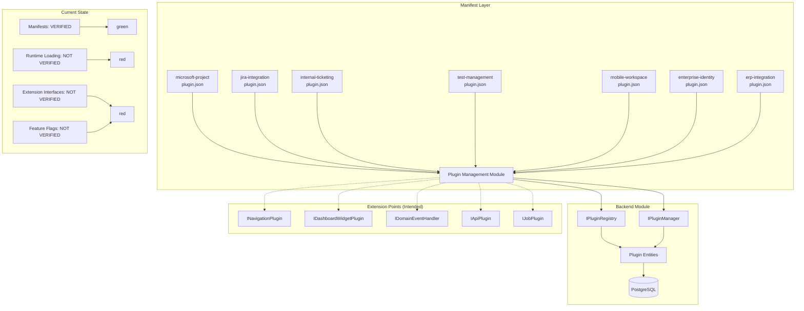

# Plugin Architecture

NEXUS PMO provides a plugin system with manifest definitions and a Plugin Management backend module. The current state is **manifest-only** -- no runtime plugin loading code is implemented.

---

## Plugin Manifests

7 plugin directories exist under `plugins/`, each containing a `plugin.json` manifest file. No runtime code exists in any plugin directory.

### Manifest Contract Fields

| Field | Type | Description | Example |
|-------|------|-------------|---------|
| `id` | string | Unique plugin identifier | `nexus.plugin.jira-integration` |
| `name` | string | Display name | `Jira Integration` |
| `version` | string | SemVer version | `1.0.0` |
| `description` | string | Capability description | `Two-way synchronization with Jira...` |
| `author` | string | Plugin author | `NEXUS PMO` |
| `dependencies` | string[] | Required module IDs | `["nexus.module.integrations"]` |
| `permissions` | string[] | Required permissions | `["Integration.Manage"]` |
| `configurationSchema` | object | JSON Schema for settings | Properties object |
| `navigationContributions` | object[] | Sidebar nav item additions | Array of NavItem |
| `dashboardWidgetContributions` | object[] | Dashboard widgets | Array of Widget |
| `eventSubscriptions` | string[] | Domain events to handle | `["task.created"]` |
| `featureFlags` | string[] | Feature flag names | `["jiraIntegration"]` |
| `minApiVersion` | string | Minimum platform API version | `1.0.0` |
| `requiredModules` | string[] | Required backend modules | `["nexus.module.integrations"]` |
| `status` | string (optional) | Plugin status marker | `"placeholder"` |

**Evidence:** Verified from all 7 `plugins/*/plugin.json` files.

---

## Plugin Catalogue

### microsoft-project

| Field | Value |
|-------|-------|
| **Status** | Manifest only |
| **ID** | `nexus.plugin.microsoft-project` |
| **Version** | `1.0.0` |
| **Dependencies** | `nexus.module.project-management`, `nexus.module.resource-management` |
| **Permissions** | `Project.Import`, `Project.Export`, `Project.ManageBaseline` |
| **Feature flag** | `microsoftProjectImport` |
| **Contributions** | 2 nav items, 2 dashboard widgets |
| **Events** | `project.created`, `project.updated` |
| **Description** | Import/export MS Project MPP/XML files, task/resource mapping, baseline comparison |
| **Evidence** | `plugins/microsoft-project/plugin.json` |

### jira-integration

| Field | Value |
|-------|-------|
| **Status** | Manifest only |
| **ID** | `nexus.plugin.jira-integration` |
| **Version** | `1.0.0` |
| **Dependencies** | `nexus.module.integrations`, `nexus.module.work-items` |
| **Permissions** | `Integration.Manage`, `Task.Create`, `Task.Edit` |
| **Feature flag** | `jiraIntegration` |
| **Contributions** | 1 nav item, 2 dashboard widgets |
| **Events** | `task.created`, `task.updated`, `task.deleted` |
| **Description** | Two-way sync with Jira: issue type/status/user mapping, JQL filters, webhooks |
| **Evidence** | `plugins/jira-integration/plugin.json` |

### internal-ticketing

| Field | Value |
|-------|-------|
| **Status** | Manifest only |
| **ID** | `nexus.plugin.internal-ticketing` |
| **Version** | `1.0.0` |
| **Dependencies** | `nexus.module.work-items`, `nexus.module.workflow-engine` |
| **Permissions** | `Task.Create`, `Task.Edit`, `Task.Assign`, `Workflow.Design` |
| **Feature flag** | `internalTicketing` |
| **Contributions** | 3 nav items, 3 dashboard widgets |
| **Events** | `task.created`, `task.updated`, `task.assigned` |
| **Description** | Built-in ticketing system with queues, SLAs, escalations |
| **Evidence** | `plugins/internal-ticketing/plugin.json` |

### test-management

| Field | Value |
|-------|-------|
| **Status** | Manifest only |
| **ID** | `nexus.plugin.test-management` |
| **Version** | `1.0.0` |
| **Dependencies** | `nexus.module.project-management` |
| **Permissions** | `Task.Create`, `Task.Edit`, `Report.View` |
| **Feature flag** | `testManagement` |
| **Contributions** | 4 nav items, 3 dashboard widgets |
| **Events** | `project.phase.changed`, `task.updated` |
| **Description** | Test case management, suites, plans, cycles, executions, coverage |
| **Evidence** | `plugins/test-management/plugin.json` |

### mobile-workspace

| Field | Value |
|-------|-------|
| **Status** | Manifest only |
| **ID** | `nexus.plugin.mobile-workspace` |
| **Version** | `1.0.0` |
| **Dependencies** | `nexus.module.work-items`, `nexus.module.notifications`, `nexus.module.approvals` |
| **Permissions** | `Task.Create`, `Task.Edit`, `Task.Complete` |
| **Feature flag** | `mobileWorkspace` |
| **Contributions** | 0 nav items, 3 dashboard widgets |
| **Events** | `task.assigned`, `task.updated`, `approval.requested`, `notification.sent` |
| **Description** | Mobile-optimized workspace for tasks, approvals, notifications |
| **Evidence** | `plugins/mobile-workspace/plugin.json` |

### enterprise-identity-placeholder

| Field | Value |
|-------|-------|
| **Status** | Placeholder (v0.1.0) |
| **ID** | `nexus.plugin.enterprise-identity` |
| **Version** | `0.1.0` |
| **Dependencies** | `nexus.module.identity` |
| **Permissions** | `Administration.Manage` |
| **Feature flag** | `enterpriseIdentity` |
| **Contributions** | 1 nav item, 0 dashboard widgets |
| **Events** | None |
| **Description** | Enterprise identity provider: Entra ID, AD, SAML, OIDC, SCIM |
| **Evidence** | `plugins/enterprise-identity-placeholder/plugin.json` |

### erp-integration-placeholder

| Field | Value |
|-------|-------|
| **Status** | Placeholder (v0.1.0) |
| **ID** | `nexus.plugin.erp-integration` |
| **Version** | `0.1.0` |
| **Dependencies** | `nexus.module.integrations`, `nexus.module.cost-management` |
| **Permissions** | `Integration.Manage` |
| **Feature flag** | `erpIntegration` |
| **Contributions** | 1 nav item, 0 dashboard widgets |
| **Events** | None |
| **Description** | ERP integration: SAP, Oracle, Microsoft Dynamics |
| **Evidence** | `plugins/erp-integration-placeholder/plugin.json` |

---

## Plugin Management Module

| Aspect | Detail |
|--------|--------|
| **Namespace** | `NEXUS.Modules.PluginManagement` |
| **Registered in** | `Program.cs:116` -- `AddPluginManagementModule()` |
| **Maturity** | Implemented (entities, controllers, service interfaces exist) |

### Domain Entities
| Entity | DbSet | Purpose |
|--------|-------|---------|
| Plugin | `Plugins` | Plugin metadata, version, status |
| TenantPlugin | `TenantPlugins` | Per-tenant plugin activation (Status, ActivatedAt, Configuration JSON) |
| PluginDependency | `PluginDependencies` | Plugin dependency declarations |

**Evidence:** `AppDbContext.cs:134-136`

### Service Interfaces
| Interface | File | Purpose |
|-----------|------|---------|
| `IPluginRegistry` | `Application/IPluginRegistry.cs` | Plugin metadata registration |
| `IPluginManager` | `Application/IPluginManager.cs` | Plugin lifecycle management |
| `PluginRegistryService` | `Application/PluginRegistryService.cs` | Implementation |

### Controller
| Endpoint | Controller File |
|----------|----------------|
| `GET /api/plugins` | `PluginController.cs` |
| `GET /api/plugins/{id}` | `PluginController.cs` |
| `POST /api/plugins/{id}/install` | `PluginController.cs` |
| `POST /api/plugins/{id}/activate` | `PluginController.cs` |
| `POST /api/plugins/{id}/deactivate` | `PluginController.cs` |
| `DELETE /api/plugins/{id}` | `PluginController.cs` |

---

## Extension Points (Intended)

The following extension point interfaces are **documented** in `docs/architecture/plugin-architecture.md` but **not verified as implemented** in the codebase:

| Extension Point | Interface | Purpose |
|----------------|-----------|---------|
| Navigation | `INavigationPlugin` | Add sidebar nav items |
| Dashboard Widgets | `IDashboardWidgetPlugin` | Custom dashboard widgets |
| Domain Events | `IDomainEventHandler<TEvent>` | Subscribe to domain events |
| API Endpoints | `IApiPlugin` | Register additional controllers |
| Background Jobs | `IJobPlugin` | Recurring background jobs |
| Report Providers | `IReportProviderPlugin` | Custom report types |
| Data Sources | `IDataSourcePlugin` | External data sources |
| Authentication | `IAuthProviderPlugin` | SSO/OAuth providers |
| UI Extensions | `IUiPlugin` | Custom UI components |
| Approval Flows | `IApprovalPlugin` | Custom approval workflows |

---

## Current State Assessment

- **All 7 plugins are manifest-only**: `plugin.json` exists, no runtime code
- **No runtime plugin loading engine**: No assembly scanning, `AssemblyLoadContext`, or `IPlugin` interface implementation verified
- **Plugin Management backend is structurally ready**: Entities, controllers, and service interfaces exist but have no real plugin discovery or lifecycle logic
- **Feature flags defined but not evaluated**: `featureFlags` arrays exist in manifests but no code reads them
- **No plugin isolation**: No sandboxing, process isolation, or permission scoping implemented

