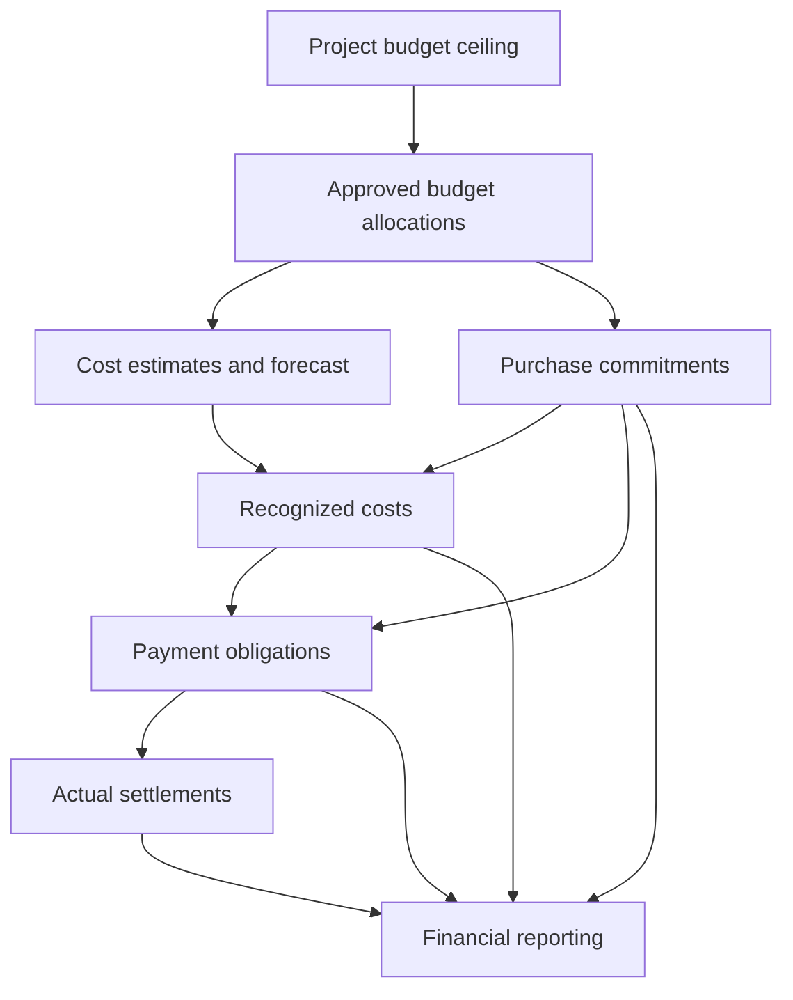

# Financial Management: Target Business Model and Architecture

> **Authorization supersession (2026-11-03):** This document retains its historical target-model decisions and proposals. Any statement below treating `Finances.Read` or `Finances.Write` as current is superseded: these aliases are retired and unsupported by current API/UI authorization. Use the canonical operation mapping in the [permission model](../architecture/permission-model.md) and [permission audit matrix](../security/permission-audit/ACTION-PERMISSION-MATRIX.csv). Runtime and persisted grant state remain unverified.

**Status:** Product Owner approved Project Financial Management Part 1 and Sprints 1-6 source scopes. Project-owned annual budgets, requests, settlements, reversals, and closing remain the sole financial sources; Sprint 6 adds computed read-only parent rollups. Consolidated technical closure, database verification/deployment, and runtime UAT remain gated.  
**Review date:** 2026-10-29  
**Related audit:** [FINANCIAL-CURRENT-STATE-AUDIT.md](FINANCIAL-CURRENT-STATE-AUDIT.md)  
**Related roadmap:** [FINANCIAL-REDESIGN-ROADMAP.md](FINANCIAL-REDESIGN-ROADMAP.md)  
**Related existing lifecycle note:** [FINANCIAL-MANAGEMENT-PLANNED-PAYMENTS.md](FINANCIAL-MANAGEMENT-PLANNED-PAYMENTS.md)

**Current implementation addendum (2026-10-31):** Project ceiling and annual allocation semantics, initial Draft behavior, ceiling controls, and annual review lifecycle are specified in [FINANCIAL-PROJECT-LIFETIME-CEILING-ANNUAL-BUDGET-LIFECYCLE.md](FINANCIAL-PROJECT-LIFETIME-CEILING-ANNUAL-BUDGET-LIFECYCLE.md). That addendum records the later Product Owner decision and source implementation; earlier target-model proposals below remain context, not a replacement for the current persisted model.

## 1. Design goals and preserved rules

The target should provide one auditable set of financial facts and one calculation contract, without turning FOPX PM into a general ledger or ERP. A Project's approved budget, its allocated budget lines, recognized costs, commitments, payment obligations, and cash settlements remain different records with different meanings.

The following agreed rules are preserved as requirements:

1. One planned payment obligation can have multiple actual settlements.
2. Partial settlements are supported.
3. Outstanding balance is obligation amount less valid applied settlements.
4. Due status and settlement/paid status are separate dimensions.
5. A settlement does not automatically create a `CostEntry`.
6. A settlement does not automatically deduct from the approved Project Budget.
7. Milestone association is optional and informational only.
8. Historical settlements and published reporting snapshots remain accurate and immutable as applicable.
9. No existing financial capability or data is removed before approved replacement scope and preservation/migration plans exist.

Planned payments and settlements should continue to represent payment obligations and cash paid; they must not be used as substitutes for cost recognition, commitments, or budget approvals.

## 2. Financial lifecycle

The arrows mean “may be associated with or report alongside,” not automatic creation. In particular, posting a settlement never creates a cost or changes a budget allocation. Commitment-to-cost and commitment/payment links must be explicit and amount-aware so that a recognized cost or payment does not count the same exposure twice.

## 3. Proposed domain records and ownership

Names below describe responsibilities; final table and API names should follow repository conventions and be decided during implementation design.

| Record | Responsibility and source of truth | Key relationships / invariants |
|---|---|---|
| **Project Budget Baseline / Budget Decision** | Immutable record of the initial approved project ceiling and each approved change, including amount, currency, effective date, reason, approver, source request, and prior/new values. Current ceiling is the latest effective approved decision. | Owned by one tenant and project. Do not infer the project ceiling by summing allocation lines. Preserve Project Change Request linkage. |
| **Budget Allocation** | Approved or proposed allocation of a portion of the project ceiling to a cost category, fiscal period, or work package. Planned, approved, and forecast values have separate meanings. | Project-owned for MVP. Sum of active approved allocations must not exceed the approved project ceiling unless a PO-approved exception is recorded. Do not store mutable actual/committed copies as authoritative facts. |
| **Budget Revision Request / Decision** | Request, review, and immutable approval/rejection decision for changes to an approved allocation. Retains previous/proposed values and comments. | Revision is approved only once by an authorized reviewer other than its requester, unless PO approves an emergency exception. Accepted amount update and approval event are atomic. |
| **Cost Category** | Tenant or system-managed category tree with stable code, active state, and controlled reporting classification (for example labor, materials, services, travel, other). | A posted cost references a valid category code. Labels can be localized in UI; stable codes drive reports. Final category taxonomy is a PO decision. |
| **Cost Estimate / Forecast Item** | Forward-looking estimate to complete, tied to project and optionally allocation/category/work package, with method, owner, confidence, and as-of date. | Must be identifiable as forecast, not actual. A forecast version is retained for published reporting. Do not silently treat an approved budget line as a forecast. |
| **Cost Entry** | Record of a cost incurred or recognized under the chosen business recognition rule, independent of when it is paid. Captures amount, currency, category, incurred/recognized dates, description, vendor/resource, source, tax treatment, evidence reference, status, and optional allocation/commitment link. | Project/tenant ownership is mandatory for MVP finance reporting. State changes are controlled; posted facts are corrected with compensating adjustments, not silent edits/deletes. |
| **Commitment** | Authorized future contractual/purchase exposure, with supplier/reference, approved amount, currency, start/effective date, status, and optional allocation/category. | A project-owned commitment can have amendments, releases, cost allocations, and payment links. Do not subtract payments or costs twice; amounts matched to recognized costs reduce remaining commitment. |
| **Commitment Change / Release** | Append-only increase, decrease, cancellation, or release event with reason, actor, approval, and effective date. | Current authorized amount is derived from accepted original amount plus approved increases less approved releases. Preserve original history. |
| **Commitment Cost Allocation** | Amount-level linkage from a recognized Cost Entry or invoice-derived cost to a commitment, for exposure reconciliation. | Total linked amount cannot exceed the recognized cost or commitment's unreconciled authorized amount. A cost may be split across commitments only through explicit allocation rows. |
| **Payment Obligation** | Planned amount due from a project, with due date, purpose/reference, payee/vendor, currency, approval state, and optional informational milestone. | One obligation has zero or many settlements. Obligation amount changes after settlement require controlled revision and cannot fall below net valid settlements. It remains distinct from commitment and cost. |
| **Payment Settlement** | Immutable record of an actual payment applied to an obligation: amount, settlement date, reference, method if needed, idempotency key, evidence, actor, and status. | Positive amount; same currency as the obligation for MVP; cannot over-settle net obligation. No update/delete. Settlement never generates a cost/budget mutation. |
| **Settlement Reversal / Adjustment** | Compensating immutable event that reverses all or part of a settlement or corrects a reference, with reason, authorizer, timestamp, and original settlement link. | Net valid settlement = posted settlements − accepted reversals/credits. A reversal does not erase the original settlement. Reversal approval requirements are a PO decision. |
| **Financial Evidence Reference** | Stable link to an approved document/storage item or external reference for approvals, cost support, commitment source, invoice, and settlement evidence. | Evidence access follows project, tenant, and financial authorization; avoid copying sensitive contents into audit JSON. |
| **Financial Snapshot** | Immutable published financial values with currency, reporting cutoff, captured timestamp, source IDs/versions, formula version, and calculation outcome. | Published snapshot values never change. A correction is a new publication/revision, visibly linked to the prior snapshot; it does not mutate history. |

### Ownership boundaries

- Project Management owns the project and the project approved-ceiling decision workflow (currently through approved Project Change Requests). Finance owns budget allocation, financial facts, approval actions, calculations, and evidence relationships.
- Program and Portfolio own membership and management scope. They do not own a second copy of project actuals or commitments. Portfolio-level investment budgets, if approved as a requirement, must be explicit parent-owned allocations with explicit transfers to project ceilings; they must not be added on top of the same child project allocations in a roll-up.
- Resource Management owns time/resource source facts and rate cards. Finance owns cost recognition. The rule that converts approved time and a rate into project actual cost must be explicit and must prevent duplicate labor entries.
- Notifications deliver events but are not the source of payment state or approval state.
- The general Approval and Workflow modules can deliver workflow mechanics, but Finance remains the authority for valid financial transitions and amount checks.

## 4. Proposed state machines

### 4.1 Budget allocation and revision

| Entity | Proposed states | Allowed transition summary |
|---|---|---|
| Allocation | `Draft`, `PendingApproval`, `Approved`, `Suspended`, `Closed` | Draft can be submitted or cancelled; pending can be approved/rejected; approved changes are made through revision decisions; suspension/closure records an effective date and reason. |
| Revision request | `Draft`, `Submitted`, `Approved`, `Rejected`, `Withdrawn` | Submission freezes the proposed values; an authorized different approver decides; approval atomically updates the current allocation and records the decision. |

The initial approved allocation is a versioned decision. It must be possible to distinguish the original baseline, approved revisions, and current approved value. Project ceiling changes and allocation changes remain separate approval events.

### 4.2 Cost recognition

| Entity | Proposed states | Allowed transition summary |
|---|---|---|
| Cost entry | `Draft`, `PendingApproval`, `Posted`, `Rejected`, `Reversed` | Draft/pending items are excluded from actual cost; only `Posted` entries count. Reversal is a linked compensating entry, not deletion. Whether every entry needs approval or only threshold/category cases is a PO decision. |

Use incurred date and recognized date separately if reporting needs both. For reporting as-of cutoff `T`, an entry counts only when its accepted posting/recognition event is effective on or before `T`. A future-dated incurred cost is not automatically posted early.

### 4.3 Commitment

| Entity | Proposed states | Allowed transition summary |
|---|---|---|
| Commitment | `Draft`, `PendingApproval`, `Open`, `PartiallyRecognized`, `Closed`, `Cancelled` | Approval creates an open authorized commitment. Cost recognition reduces its remaining exposure only through explicit allocation. Close/cancel is allowed only after remaining exposure is released or reconciled and no forbidden linked obligation remains. |

### 4.4 Payment obligation and settlement

| Entity | Proposed states | Allowed transition summary |
|---|---|---|
| Payment obligation approval | `Draft`, `PendingApproval`, `Approved`, `Cancelled` | Approval authorizes an obligation; due status is calculated independently. Changes after settlement use revision history. Cancellation is blocked or specially approved when net settlements are nonzero. |
| Settlement | `Pending`, `Posted`, `Rejected`, `Reversed` | A valid posted settlement is immutable. Corrections are explicit reversal/adjustment records. `Pending` and `Posted` are distinct only if the payment evidence/reconciliation workflow requires it; PO decision. |

Due status should be a separate projection: `Upcoming`, `Due`, `Overdue`, or `Settled` based on approved obligation, net outstanding amount, due date, and the agreed tenant/project timezone. This does not replace the obligation's approval state or settlement status.

## 5. Source records, formulas, and timing

All formulas below are calculated for a tenant, project set, currency, and cutoff timestamp/date. The calculation service must return the formula/version and “unavailable” when required source data is missing; it must not silently substitute GBP/USD or mix currencies.

Notation: `T` is the reporting as-of timestamp; `C` is one currency; `P` is the unique project set in the requested scope. An item is included only if tenant, ownership, currency, state, and effective date are valid for the metric.

| Metric | Exact source records and formula | Lifecycle/as-of timing | Double-count protection |
|---|---|---|---|
| **Initial budget baseline** | First approved Project Budget Decision for `P,C`. | Effective approved decision as of project start/initial approval. | Keep separate from later project ceiling and allocation lines. Do not sum parent Portfolio/Program fields. |
| **Current approved project budget** | `B(T) = sum(amount of approved Project Budget Decisions effective by T)`; for a simple amendment ledger this is the current approved ceiling from the latest decision. | Only approved decisions effective by `T`; drafts/submissions excluded. | One current amount per project/currency. A budget revision is not a project ceiling revision. |
| **Approved allocated budget** | `A(T) = sum(current approved Budget Allocation amounts effective by T)` for project/currency. | Include approved allocation versions as-of `T`, not proposed drafts. | Allocation is a breakdown of `B`, not extra budget. Enforce or explicitly flag `A(T) > B(T)`. |
| **Budget consumption by actual** | `Actual(T) / B(T)`; if desired, allocation consumption is `Actual linked to allocation / approved allocation`. | Posted cost effective by `T`; exact actual-cost rule below. | Do not include commitments or payments in actual cost. No silent mixing of labor and direct costs. |
| **Actual cost** | Sum net posted Cost Entries recognized by `T`, plus any approved resource-time cost generated under the chosen labor rule, less accepted reversals. | Exclude draft/rejected/unposted items and entries recognized after `T`. Use currency `C` only. | Each source time-entry or invoice is recognized once. Settlement is not a cost source. Commitment link is metadata/reconciliation, not an additional amount. |
| **Gross active commitment** | Sum approved original Commitment amounts plus approved amendments effective by `T`, less approved releases; include only commitments not cancelled/closed as of `T`. | Approval/effective dates determine inclusion. | Do not add a separate `InvoicedAmount` copy. The source is the approved commitment event history. |
| **Remaining commitment** | For each commitment, `max(0, authorized amount − cost amount allocated/recognized against commitment − released amount)`. Aggregate remaining values by `P,C`. | Current as-of values use accepted commitment changes and linked cost allocations effective by `T`. | A linked recognized cost moves exposure from remaining commitment to actual cost; it is not counted in both. An invoice must not be counted separately if its value is already a recognized cost. |
| **Committed exposure** | `Actual(T) + RemainingCommitment(T)` as the core cost exposure measure. | Posted actual plus authorized unreconciled commitment at `T`. | Excludes payment obligations by default; a payment obligation backed by the same commitment/cost is not added again. Whether an unbacked approved payment reserves budget is an explicit PO decision. |
| **Paid amount** | Sum posted settlements effective on/before `T` minus accepted reversals effective on/before `T`. | Settlement/cash date controls; separate from incurred/recognized cost date. | Never add to actual cost or commitment exposure. Report separately. |
| **Outstanding payment obligation** | For each approved obligation, `max(0, approved obligation amount as-of T − net valid applied settlements as-of T)`. | Approved amount and settlements effective by `T`; due bucket calculated using agreed timezone. | Count only obligation records. Do not add outstanding again to committed exposure if backed by a commitment already counted. |
| **Overdue payment amount** | Sum outstanding approved obligations with `dueDate < localDate(T)` for the configured timezone. | Evaluate at report time using a stored/reportable timezone rule. | Same obligation contributes to outstanding and overdue subtotal; overdue is a subset, never an additional exposure. |
| **Forecast to complete (ETC)** | Sum current forecast items remaining after `T`, with an approved method and version. | Forecast snapshot as-of `T`; include planned future work/cost only. | Do not include posted actuals again. Exclude commitment amounts already represented in forecast, or explicitly net them out. |
| **Forecast at completion (EAC)** | `EAC(T) = Actual(T) + ETC(T)`. | Actual through cutoff plus remaining forecast as-of cutoff. | Do not sum full forecast and actual if forecast already contains actual-to-date. Formula must be carried by formula version. |
| **Budget variance** | `BudgetVariance(T) = B(T) − Actual(T)`; positive is under budget, negative is over budget. | Current approved ceiling versus actual through `T`. | Commitment exposure is not actual cost. |
| **Forecast variance** | `ForecastVariance(T) = B(T) − EAC(T)`; positive is forecast under budget, negative is forecast over budget. | Current approved ceiling versus EAC at the same cutoff. | Do not label `approved allocation − line forecast` as project forecast variance unless the metric is explicitly called allocation forecast variance. |
| **Available budget after cost exposure** | `Available(T) = B(T) − Actual(T) − RemainingCommitment(T)`. Show negative values as over-committed rather than clamp to zero. | Approved ceiling, posted actual, remaining approved commitment at same cutoff. | Does not subtract settlements. Does not add payment obligations by default. Unbacked payment reserve treatment requires PO approval. |
| **Allocation remaining** | Per allocation: `approved allocation − posted actual allocated to it − remaining commitment allocated to it`. | Allocation and linked transactions as-of `T`. | Only explicit cost/commitment allocations count; don't distribute unmatched costs by guesswork. |
| **Portfolio/Program totals** | For each currency independently, sum project-level values once across the unique authorized project set. Add separately identified parent-level allocations only where the PO-approved parent-to-project transfer model says they are not already in child project ceilings. | Each child project uses the same cutoff and formula version. | Deduplicate project IDs; never sum both project data and parent `ActualSpend`/budget copies. Do not produce mixed-currency grand totals without an approved FX policy and stored rates. |

### Important separation of measures

- **Budget remaining** is a budget control measure; it is not cash in a bank account.
- **Actual cost** is incurred/recognized cost; it is not amount paid.
- **Commitment** is an authorized future exposure; it is not necessarily an invoice or payment.
- **Payment obligation** is an amount approved to be paid on a schedule; it does not itself prove that a cost has been recognized.
- **Settlement** is cash paid/applied; it does not by itself change cost or approved budget.
- **EAC** is actual plus a separately defined estimate of remaining cost; it is not automatically the approved budget.

## 6. Target architecture

### Calculation and read models

Create one finance calculation service with explicit inputs: tenant, authorized project IDs, currency, cutoff, and formula version. It should be the only implementation of the shared formulas. Project dashboard, global finance overview, Program/Portfolio rollups, exports, and status report capture should consume the same typed result/projection. A snapshot stores the calculated values and source/version metadata; it should not run an alternate formula at publication time.

The service should return separate fields for approved ceiling, approved allocations, recognized actual cost, remaining commitment, payment paid, payment outstanding, EAC, variance, and availability. Never expose an ambiguous `Actual` or `Remaining` field without a metric definition and currency.

### Transaction and idempotency requirements

- Each approval decision and its resulting finance state change is one database transaction.
- Each settlement insert, parent obligation version change, and audit event is atomic. The idempotency key is unique within tenant and obligation; retries with the same payload return the original result, while changed payloads conflict.
- Each commitment change/release and linked reconciliation update is atomic.
- Each cost posting and reversal is atomic with its audit/change event.
- Require current concurrency tokens on all finance writes; missing tokens fail validation. Use database constraints for tenant-scoped foreign keys, valid ownership, unique active revisions, idempotency, and immutable published snapshots where the database supports them.
- On a conflict, return a clear conflict response with current version rather than silently overwriting.

### Audit, correction, and evidence

Persist a finance audit/change event in the same transaction as every approval, posting, amendment, settlement, reversal, and publication. Include actor, timestamp, correlation/idempotency identifiers, previous/current version, effective date, reason, and source linkage. Preserve original financial facts; correct them with compensating records. Soft deletion may hide a draft, but must not erase a posted record or published snapshot.

Financial evidence should reference the existing document/evidence boundary instead of embedding uncontrolled files in financial tables. Evidence authorization must be evaluated through tenant and project scope.

### Tenant/project/program/portfolio isolation

- Tenant ID is required and validated on all financial entities and relationships.
- Project-owned finance data requires a project ID, including when entered through a budget/allocation relationship. A service must resolve project ownership before authorization; null project IDs cannot bypass scope checks.
- All lists, summary endpoints, detail routes, and create/update commands apply the same fail-closed management scope. An empty authorized project set returns no project finance data.
- Program/Portfolio access first resolves the authorized project set, then aggregates unique project records. Parent-specific allocations use a separate parent-owned source and explicit transfer relationships.
- Cross-currency summaries remain grouped by currency until an FX policy is approved. Do not fall back to GBP/USD when a source currency is missing.

### Authorization by financial action

Keep `Finances.Read` and `Finances.Write` as broad capability gates if needed, but enforce action-level authorization in finance services and workflow transitions. The proposed action matrix is:

| Action | Proposed authorization boundary |
|---|---|
| View project finance | Finance read plus project/management scope. |
| Create or edit draft allocation/cost/commitment/obligation | Finance write plus project scope. |
| Approve project ceiling or budget allocation change | Explicit budget-approval permission/role, amount threshold, separation from requester; source Project Change Request for ceiling. |
| Post/approve cost | Explicit cost-post/approval permission and amount/category rules decided by PO. |
| Approve commitment or payment obligation | Explicit commitment/payment-approval permission, amount threshold, separation from requester. |
| Record settlement | Payment execution permission plus obligation scope; reversal is a separate permission. |
| Reverse/adjust posted financial fact | Dedicated correction permission, reason, source record, and approval threshold. |
| Publish financial snapshot | Report publication permission and source-scope access; published content is immutable. |

This is a target proposal, not a claim about the current role catalog. Roles, thresholds, delegation, and emergency authority require PO approval.

### Currency and precision

- Persist currency code with every money source and result; derive it from an authoritative project/parent context or require explicit input, never silently default missing currency.
- Reuse the current four-decimal database scale only if Finance confirms it matches all currencies/business needs. Validate input scale before persistence; define rounding mode at the calculation boundary and do not rely on database rounding.
- Keep aggregation separated by currency. If FX is later approved, record source currency, target currency, rate, rate source, and effective timestamp on the converted report value; preserve the original currency amount.
- Tax inclusion/exclusion and gross/net budget treatment are PO decisions. Store tax components separately if required and report the selected policy consistently.

### API boundaries

Keep APIs aligned to domain commands and queries rather than generic CRUD for posted facts:

- Budget: baseline/current ceiling read; allocation list/detail; revision submit/approve/reject; allocation history.
- Costs: draft/create, submit/post/approve, correction/reversal, cost estimate/forecast, category catalog.
- Commitments: create/approve, amend/release, close/cancel with reconciliation checks, linked recognized costs.
- Payments: obligation draft/approve/revise/cancel; append settlement; reverse/adjust settlement; read obligation balance and due projection.
- Reporting: shared finance summary at project/program/portfolio scope with currency and `asOf`; immutable snapshot publication and retrieval.

Every write accepts a concurrency version. Commands carry explicit reason/evidence references for controlled financial transitions. API DTOs should use enumerated state/category codes, not arbitrary status strings.

### Frontend information architecture

1. **Project Finance Overview:** approved ceiling, allocated budget, actual cost, remaining commitments, available budget, EAC/variance, paid and outstanding payments, each with as-of date and drill-through.
2. **Budget:** baseline/current ceiling, allocation by category/period, revision history and approval queue.
3. **Costs & Forecast:** drafts awaiting approval, posted actuals, category/resource breakdown, adjustments, forecast-to-complete and forecast method.
4. **Commitments:** authorized amount, cost matched, remaining exposure, amendment/release history, supplier and linked obligations.
5. **Payments:** obligation schedule, due status, settlement status, partial settlements, evidence, outstanding amount, correction workflow and notifications.
6. **Program/Portfolio Finance:** currency-separated totals and project drill-down; no unlabeled parent totals or duplicate child values.
7. **Published Reports:** immutable snapshot details with source/cutoff/formula version and explicit corrected/reissued report relationship.

The UI should distinguish due status from payment status and actual cost from cash paid. Use authoritative API values; show missing/unavailable currency or forecast as unavailable rather than zero or a default currency.

## 7. MVP versus later enterprise scope

### Core MVP

- One approved project-ceiling history and one controlled allocation revision workflow.
- Standard cost categories and an explicit cost posting/recognition lifecycle.
- A defined labor-cost source rule that cannot double-count time.
- Commitment approvals, amendments/releases, and amount-level matching of recognized costs to commitment exposure.
- Preserve planned obligations and multi-settlement support; add reversal/correction and evidence references.
- Shared formulas for project summaries, forecast, currency-separated Program/Portfolio rollups, and immutable published snapshots.
- Fail-closed tenant/project scope and action-level permissions for approvals, posting, settlement, and reversal.
- Full concurrency/idempotency and atomic audit evidence for financial state changes.
- Data reconciliation and non-destructive migration plan before any cutover.

### Future enterprise enhancements (only with demonstrated need)

- Vendor invoice capture, 2/3-way matching, tax validation, and accounts payable workflow.
- Procurement-system/ERP integration and synchronization controls.
- FX-converted portfolio reporting with rate-source governance.
- Multi-entity accounting, general ledger, journal entries, accruals, capitalization, depreciation, and fiscal-close controls.
- Scenario/sensitivity forecasting and statistical cost-to-complete models.
- Automated invoice/payment evidence capture or bank/payment provider integration.
- Configurable SLA/escalation matrices beyond the agreed notification recipient model.

These are not assumed MVP requirements. The existing `Invoice` entity alone does not establish an invoice workflow requirement.

## 8. Product Owner Decision Register

### 8.1 Approved decisions applicable to Part 1 and Financial Sprints 1-4

These decisions are approved for implementation and are not awaiting further approval:

- Project-level Finance only. The initial approved budget is recorded at project creation or through an authorized initialization, in the configured project currency. Preserve its original value and history; approved changes use the existing Project Change Request path.
- An approved Payment Request reserves its approved amount once. Draft and Pending requests do not reserve. `Available Budget = Approved Budget - active approved Payment Request allocations`. Prevent over-allocation and duplicate reservation under concurrent approval. Settlements do not reserve or deduct the request allocation a second time. A Settlement never automatically creates a `CostEntry` or deducts the approved project budget.
- Only an authorized Project Manager creates a project Payment Request. It has a title, positive amount in the configured project currency, free-text reason, and optional milestone. Approvers are selected from eligible active Project Team members and validated by the server.
- Project financial approval configuration supports `Sequential`, `Parallel`, and `Both`; with `Both`, the Project Manager chooses Sequential or Parallel per request. Sequential approvals follow the stored order, only the current approver may decide, and rejection stops the sequence. Parallel approvals allow Mandatory and Optional participants, require at least one Mandatory approver, require all Mandatory approvers to approve, and record Optional decisions without making them a completion gate. A Mandatory rejection rejects the request.
- An authorized cancellation may cancel a Draft or Pending Payment Request. An Approved Payment Request cannot be directly cancelled; it requires a separately approved Reversal Request. Financial Sprint 4 authorizes full or partial release of unpaid commitment only, bounded by original approved amount less actual settlements and prior approved releases. The approved release reduces the same Annual Budget allocation exactly once. It never reverses or changes paid settlements and creates no refund, cash transaction, or CostEntry. Paid-settlement correction/refund and cross-year closed-period treatment remain outside Sprint 4.
- Attachments are optional for the MVP.
- Use the existing append-only `AuditEntries` infrastructure for real financial activity. Include project and tenant scope, actor, UTC timestamp, request/financial reference, amount, currency, and meaningful before/after values. Record creation, edit, submit, cancellation, approval method and participants, each decision, final result, reservation, and reversal decisions in the same unit of work as the corresponding mutation.
- Put the financial foundation, existing operations, and Financial Activity in Project Details → Financial. Preserve existing financial screens and historical records. Do not build Program/Portfolio Finance.
- Show only source-backed values in financial summaries. Payment Request allocations and Available Budget remain unavailable until their approved source records exist; do not display fabricated zeroes or derive them from settlements.

### 8.1.1 Project Annual Budget Foundation — additionally authorized 2026-10-30

The separate Project Annual Budget Sprint 1 is authorized as an additive planning record, not as an update to the earlier Part 1 or Payment Request business rules:

- A Project has at most one annual budget per Tenant fiscal year. Fiscal-year label and date boundaries derive from the Tenant fiscal calendar; currency derives from the Project.
- Total annual budget is `NewApprovedFunding + ApprovedCarryForward + ApprovedAdjustments`. Drafts are editable; approved rows are immutable and record approver and UTC approval time.
- `Project.Budget` remains the operational Payment Request ceiling. Annual budgets do not reserve or release budget, change Payment Request allocations or available-balance calculation, create CostEntries, or change settlement semantics in this Sprint.
- Carry-forward is reserved as a field but remains zero until a separately approved workflow. No historical budgets, transactions, or snapshots are backfilled or reassigned.
- Reading and draft changes use the existing `finances.read` and `finances.write` permissions. Approval requires the new `ProjectAnnualBudget.Approve` permission in addition to `finances.write`; no role grant is automatic. The initial authorization/delegation policy for this approval permission remains unresolved and approval must stay unavailable until an explicit authorized assignment is provided.

This scope authorization does not resolve D1–D17. See [Project Annual Budget Foundation](PROJECT-ANNUAL-BUDGET-FOUNDATION.md) for the source contract and deployment boundary.

### 8.1.2 Payment Request annual-budget integration - additionally authorized 2026-10-30

New Payment Requests reference the single Project Annual Budget for the server-resolved current Tenant Fiscal Year. Submission requires an Approved Annual Budget in the Project currency. Only final Approved requests reserve funds, using `Approved Annual Budget - active Approved linked Payment Request allocations`. Partial/full settlements do not reduce that reservation. The approved workflows and shared `ApprovalRequest`, `ApprovalAction`, and `AuditEntries` infrastructure remain in use. Existing requests without an Annual Budget association are preserved without backfill or inferred Fiscal Year; until a controlled reconciliation, the service blocks new spending transitions when those approved historical records could make the annual balance unsafe. `Project.Budget` is retained as the legacy ceiling and is not a fallback reservation source for new requests. This Sprint 2 authorization did not itself change settlement, cost, reversal, closing, or carry-forward semantics; the later Sprint 4 authorization below specifically defines unpaid-commitment reversal.

### 8.1.3 Unpaid Payment Request commitment reversals - authorized Financial Sprint 4

An Approved Payment Request cannot be directly cancelled. An active, authorized user with `finances.write` and `ProjectPaymentReversal.Create` in the authenticated Tenant/Project scope may create a separate Reversal Request, with explicit approver assignments and the existing sequential/parallel approval workflow. This does not impose a Project Manager-only rule. Only an Approved reversal releases its approved amount from the same Annual Budget allocation; Draft, Pending, Rejected, and Cancelled reversal requests release nothing. Reversal is limited to the unpaid commitment: `Maximum Reversible = Original Approved Amount - Valid Actual Settlements - Previously Approved Reversals`. Cumulative paid plus released amounts may never exceed the original approved amount. Multiple approved partial reversals are supported; only one reversal may be Pending for an original request at a time.

Original approvals, request amount/reference, Annual Budget association, settlements, and prior audit events remain unchanged. Effective allocation is derived as `Original Approved Amount - Approved Reversals`; remaining payable is `Effective Active Allocation - Actual Settlements`; Available Annual Budget subtracts effective active allocations once and does not subtract settlements again. No CostEntry, refund, cash movement, or settlement correction is created. The reversal retains the original project, Tenant, budget, and Fiscal Year. Release is blocked for missing/inconsistent legacy budget provenance and for a non-current Fiscal Year; closed-period/carry-forward handling remains a Sprint 5 dependency. The source reuses ApprovalRequest, ApprovalAction, approver assignments, AuditEntries, and the project-scoped financial transaction lock. EF migration/snapshot reconciliation, builds, database deployment, and runtime UAT are deferred to Sprint 7.

### 8.2 Remaining unresolved decisions from D1-D17

An approval for a bounded Part 1 rule does not approve the remaining policy in its D item. Unresolved items stay disabled or visibly unavailable until the corresponding sprint is approved.

| ID | Status | Remaining decision |
|---|---|---|
| D1 | Partially approved | `Project.Budget` is the current approved project ceiling; initial budget and approved change history are preserved. Historical reconciliation and how legacy allocation records relate to the ceiling remain open. |
| D2 | Partially approved | Payment Request allocations are deducted once from Available Budget and concurrent over-allocation is prevented. Financial Sprint 4 approves full or partial release of unpaid commitment only after a separately approved Reversal Request; settlements remain unchanged and are never released. Budget-line allocation equality and any exception path remain undecided. |
| D3 | Unresolved | Which cost lifecycle state qualifies as an actual and what category/threshold approvals apply. |
| D4 | Unresolved | Labor cost source, payroll scope, and deduplication between approved time and manual costs. |
| D5 | Unresolved | Gross/net tax basis and tax-component treatment. |
| D6 | Unresolved | Controlled cost categories, indirect costs, and shared-cost allocation. |
| D7 | Unresolved | Commitment exposure, matching against costs, releases, and closure rules. |
| D8 | Partially approved | Approved Payment Requests reserve once; settlements do not deduct again and never create costs. Whether an existing standalone Payment Obligation reserves budget, and how commitments link to requests, remain open. |
| D9 | Deferred | Whether an invoice reference or invoice workflow is needed, and its relationship to costs and payment obligations. |
| D10 | Unresolved | Forecast method/version and ETC/EAC treatment. Existing forecast displays are retained as legacy functionality pending this decision. |
| D11 | Partially approved | Existing finance permissions and Payment Request approval rules apply. Financial Sprint 4 adds distinct `ProjectPaymentReversal.Create` and `ProjectPaymentReversal.Approve` permissions and assigned-approver checks; initial delegation authority, broader role assignments, thresholds, maker-checker outside approved workflows, and settlement correction/refund permissions remain open. |
| D12 | Unresolved | Finance timezone, notification recipients, and escalation rules. |
| D13 | Partially approved | Use the configured project currency and never substitute a currency. Rounding, precision policy, and supported-currency governance remain open. |
| D14 | Deferred | No FX conversion or parent-level aggregation is included in Part 1. Future FX source/date rules remain open. |
| D15 | Partially approved | Existing published history is preserved. Correction/republication workflow and tolerances remain open. |
| D16 | Partially approved | Sprint 6 authorizes calculated read-only Program/Portfolio views from unique authorized descendant Projects. No parent budgets, allocations, transactions, closing, persisted totals, FX conversion, or historical as-of hierarchy are authorized. Legacy parent totals remain unavailable pending disposition. |
| D17 | Partially approved | Part 1 and Payment Request audit events use a project/tenant-scoped, append-only, permission-guarded trail. Retention periods and evidence-access policy remain open. |

### 8.3 Deferred future Finance capabilities

Beyond the implemented source workflows, deferred capabilities include paid-settlement reversal/correction, refunds, document/evidence workflows beyond optional attachments, invoice/AP matching, broader cost/commitment policy, forecast redesign, independent Program/Portfolio budgets or transactions, parent allocations, FX, historical hierarchy reconstruction, persisted rollup snapshots, and retention-policy implementation. Sprint 6's read-only parent rollups use current hierarchy and never persist or own financial totals.

## 9. Approval gate

The Product Owner approved Project Financial Management Part 1/Sprint 1 and the bounded Payment Request/Sprint 2 rules recorded above; Sprint 3-6 source scopes were separately authorized. Sprint 6 authorizes only calculated, read-only parent rollups and does not authorize parent budgets or financial writes. These authorizations do not permit database deployment or Production changes. EF source must pass the repository documented database workflow before a separately authorized database write. Sensitive permission delegation and remaining D1-D17 questions gate only the affected unresolved capabilities. The historical 2026-10-29 freeze report above does not establish the current migration state. Development identity, migration history, physical schema, and backup must be verified from current evidence before deployment.

## 8.4 Project Year-End Closing and carry-forward - Sprint 5 source scope

Project Year-End Closing is implemented as an explicit, approval-gated Project operation using the Tenant fiscal calendar. It snapshots allocation-based and cash-paid measures separately; actual settlements are reported by actual payment date and do not reduce budget availability twice. Closing blocks unresolved pending requests/reversals, unsafe legacy associations, unknown historical settlement currencies, and inconsistent funding ownership.

Approved free carry forward is explicit. Outstanding unpaid approved commitments are separately funded into the next Fiscal Year through append-only `ProjectPaymentRequestFundingTransfer` assignments. The original request, approval, budget association, settlement and reversal histories remain unchanged. The active transfer destination is the only current funding assignment; transfers carry the unpaid payable amount and can continue across consecutive years. Paid and released amounts are not transferred. Destination Annual Budget approval remains separate, and carried reserved allocations remain unavailable to new requests. Programs/Portfolios have no independent closing or budget.

Sensitive close and carry permissions fail closed until explicitly delegated. EF migration/snapshot reconciliation, builds, database delivery and runtime UAT remain deferred to Sprint 7A/7B. See [Sprint 5 delivery record](FINANCIAL-SPRINT-5-YEAR-END-CLOSING.md).

## 8.5 Program and Portfolio reporting - Sprint 6 source scope

Programs and Portfolios expose read-only calculated summaries from authorized Project records. Program totals include its direct Projects. Portfolio totals include each eligible Project once across Programs and direct Portfolio assignment. The API groups all monetary values by the exact currency code; it never adds across currencies or performs FX conversion. Budget availability uses approved annual budgets less effective active allocations (including approved releases and current carry-forward funding); settlement cash is reported by actual payment date, not deducted again from budget. Closing coverage is derived from the selected Project/Fiscal Year closing records, while closed financial values use immutable closing snapshots. Missing/unapproved budgets, unresolved legacy requests, partial authorization coverage, or inconsistent source data keep the parent report Provisional. Hierarchy is current, not historical as-of. Parent financial write actions remain unsupported. See the [Financial Reporting contract](FINANCIAL-PROGRAM-PORTFOLIO-REPORTING.md).
